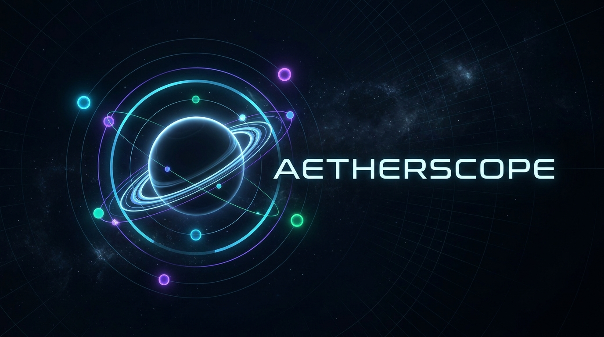
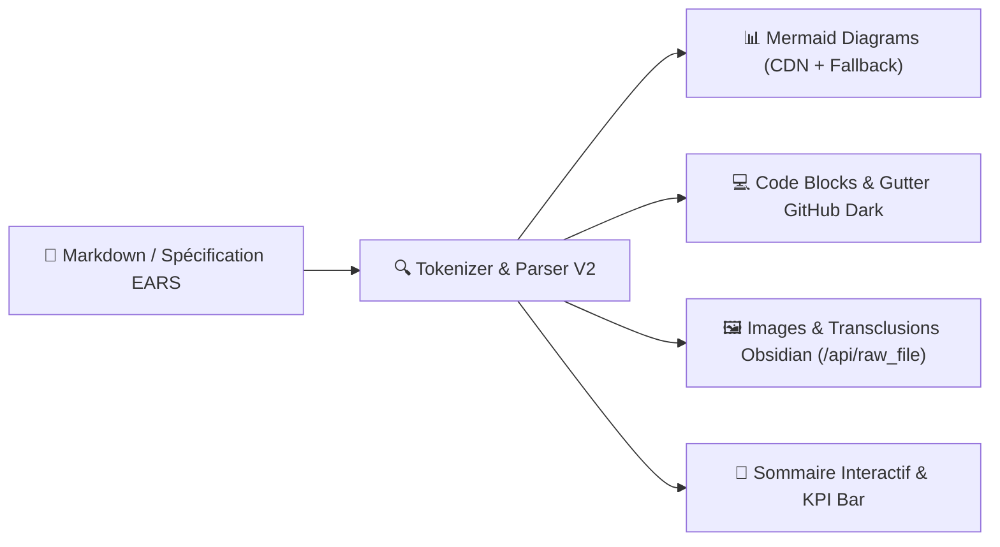
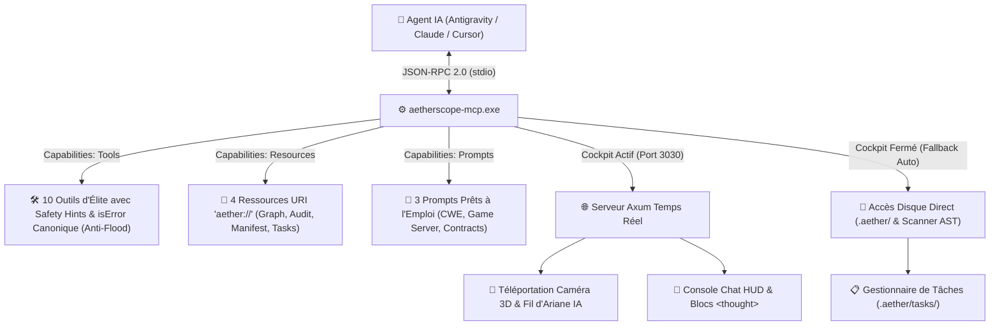

<!-- LANGUAGE BANNER -->
<p align="right">
  <b>Français</b> | <a href="./README.md">English 🇬🇧</a>
</p>

<div align="center">

<p align="center">
  
</p>

# 🪐 AetherScope V2 (`aether-engine`)

### **Cockpit Spatial d'Architecture WebGL 2 • Linter SAST Zero-Day & Hors-CWE (200+ Patterns, Stealth Backdoors & Règles CWE) • Gouvernance Cryptographique BLAKE3 • Serveur MCP & Passerelle IA "Zero-Shell"**

[](https://maxxwwim.github.io/AetherSAST-150-CWE-MCP/)
[](https://github.com/maxxwwim/AetherSAST-150-CWE-MCP/releases)
[](https://www.rust-lang.org/)
[](https://www.khronos.org/webgl/)
[](https://modelcontextprotocol.io/)
[](https://m8ven.ai/mcp/maxxwwim-aetherscope-sast-150-cwe-blake3-serveur-mcp-visualiseur-de-co-j4mhm7?s=readme)
[](./CWE_CATALOG.md)
[](./CWE_CATALOG.md)
[](#🔒-gouvernance-spec-driven-contrats-ears--sceau-blake3)
[](./docs/roadmap_2027.md)
[](#📄-licence)

<br/><br/>


</div>

---

## ⚡ Qu'est-ce qu'AetherScope V2 ?

**AetherScope V2** est un environnement d'ingénierie logicielle et d'audit de sécurité de nouvelle génération qui fusionne **quatre outils en un seul moteur natif** :

| ADN du Moteur | Ce qu'il remplace / transcende | Ce qu'apporte AetherScope V2 |
| :--- | :--- | :--- |
| 🌌 **1. Graphe Spatial Vivant** *(L'ADN Obsidian)* | Graphes statiques lents, diagrammes UML figés | **Galaxie interactive 2D/3D à 120 FPS** (Shaders SDF WebGL 2), membranes cellulaires vivantes à 12 lobes, 4 layouts mathématiques, simulation physique de Coulomb/Hooke et audio procédural. |
| 🛡️ **2. Scanner SAST & Bug Bounty** *(L'ADN Audit Zero-Day)* | Linters lents en CI/CD, bruit massif de faux positifs | **Audit statique temps réel (< 50 ms à chaque `Ctrl+S`)** avec **215 Règles (Moteur Hors-CWE `AETHER-*` Backdoors/RCE + Zero-Day CWE Rules)** (Rust/LLVM/UB/rkyv, PHP Web/FFI/Runtime, Zig Systems & C-ABI, C# / ASP.NET Core, Smart Contracts & VMs Distribuées, DeFi, ZK-SNARKs, Python, Node/V8, C/C++), masquage lexical anti-faux-positifs, routage typé et **Générateur de PoC & Scope Bug Bounty**. |
| 🏛️ **3. Cockpit IDE "Spec-Driven"** *(L'ADN Gouvernance)* | Documentation obsolète, dérive architecturale | Chaque dossier possède son contrat `README.md` (règles **EARS**, budgets de lignes, imports autorisés/interdits) **scellé cryptographiquement par BLAKE3** dans `aether.lock.toml`. Toute transgression allume un laser rouge d'alerte. |
| 🤖 **4. Serveur MCP & Pont IA "Zero-Shell"** *(L'ADN Copilot Console)* | Context loss des LLMs, réécritures destructrices, hallucinations | **Serveur MCP natif (`aetherscope-mcp.exe`)** + **Paquets `<aether_handshake>`**. L'agent IA (Antigravity, Claude, Cursor) téléporte lui-même la caméra 3D sur les bulles qu'il édite, gère ses tâches dans `.aether/tasks/` et code par diffs chirurgicaux sans jamais perdre le contexte. |

---

## 📌 Sommaire Exécutif

1. [⚡ Qu'est-ce qu'AetherScope V2 ?](#-quest-ce-quaetherscope-v2-)
2. [🔶 Nouveautés V2.4.0 — Cockpit Svelte 5 WebGL 2, Contrats BLAKE3 Modifiables en Direct (Dossier & Fichier) & Gouvernance Visuelle Orange/Rouge](#-nouveautés-v240--cockpit-svelte-5-webgl-2-contrats-blake3-modifiables-en-direct-dossier--fichier--gouvernance-visuelle-orangerouge)
3. [☢️ Nouveautés V2.3.0 — Gemini 4 Hydrogen Extra : Moteur Hors-CWE (`AETHER-*`), Portes Dérobées Invisibles & RCE Furtives](#-nouveautés-v230--gemini-4-hydrogen-extra--moteur-hors-cwe-aether--portes-dérobées-invisibles--rce-furtives)
4. [📖 Nouveautés V2.2.2 : Moteur de Documentation Markdown GitHub-Grade, Rendu Mermaid Interactif, Coloration Syntaxique & Highlighting Diff, Endpoint Raw Binary File & KPI Métriques](#-nouveautés-v222--moteur-de-documentation-markdown-github-grade-rendu-mermaid-interactif-coloration-syntaxique--highlighting-diff-endpoint-raw-binary-file--kpi-métriques)
5. [🧬 Nouveautés V2.2.1 : Support Zig & C#/.NET, Semgrep Communautaire, SSA Dataflow, SCA Reachable & Mode Vault Obsidian](#-nouveautés-v221--support-zig--cnet-semgrep-communautaire-ssa-dataflow-sca-reachable--mode-vault-obsidian)
6. [🚀 Nouveautés Majeures SAST V2.1 (Production Ready)](#-nouveautés-majeures-sast-v21-production-ready)
7. [🚀 Démarrage Rapide, CLI & API Locale](#-démarrage-rapide-cli--api-locale)
8. [🛡️ Moteur SAST, Chasse Zero-Day & Catalogue des 200+ Règles (CWE + AETHER-*)](#-moteur-sast-chasse-zero-day--catalogue-des-200-règles-cwe--aether-)
9. [🤖 Serveur MCP Natif (`aetherscope-mcp`) & Passerelle IA "Zero-Shell"](#-serveur-mcp-natif-aetherscope-mcp--passerelle-ia-zero-shell)
10. [🔒 Gouvernance "Spec-Driven", Contrats EARS & Sceau BLAKE3](#-gouvernance-spec-driven-contrats-ears--sceau-blake3)
11. [🏛️ Architecture Globale & Structure du Workspace Cargo](#-architecture-globale--structure-du-workspace-cargo)
12. [🎨 Cockpit GPU WebGL 2 : Membranes, Bulles, Lasers & Layouts](#-cockpit-gpu-webgl-2--membranes-bulles-lasers--layouts)
13. [🛠️ Outillage IDE Intégré, Scaffolding Multi-Stack & Export](#-outillage-ide-intégré-scaffolding-multi-stack--export)
14. [🕹️ Raccourcis Clavier, Compilation & Licence](#-raccourcis-clavier-compilation--licence)
15. [📄 Licence](#-licence)
16. [📚 Liste détaillée des règles CWE (répertoire dédié)](./cwe/)
17. [🔭 Feuille de Route & Architecture 2027 (SoA 100k+ Nœuds, WebGPU WGSL, Dual-Pass Laser & Économie de Tokens IA)](./docs/roadmap_2027.md)

---

## 🔶 Nouveautés V2.4.0 — Cockpit Svelte 5 WebGL 2, Contrats BLAKE3 Modifiables en Direct (Dossier & Fichier) & Gouvernance Visuelle Orange/Rouge

### 1. 🔒 Contrats BLAKE3 Modifiables en Direct par Dossier ET par Fichier (`POST /api/contracts/update`)
- **Budgets de Lignes Granulaires (`max_lines_per_file` + `file_max_lines`) :** Le frontmatter YAML de chaque contrat `README.md` accepte désormais à la fois une limite par défaut pour le dossier (`max_lines_per_file`) et un dictionnaire de surcharges par fichier (`file_max_lines`) permettant d'attribuer un budget dédié à un fichier spécifique (`linter.rs`, `scanner.rs` ou chemin relatif).
- **Empreintes BLAKE3 par Fichier & par Contrat :** Chaque nœud AST embarque désormais son empreinte `file_blake3_hash`, son dossier contrat `contract_folder`, sa limite effective `max_lines_limit` et sa surcharge éventuelle `file_max_lines_override` dans `SymbolMetadata`, tandis que `aether.lock.toml` scelle cryptographiquement chaque `README.md` (`readme_blake3`).
- **Édition 1-Clic depuis l'Inspecteur Aether (`InspectorDrawer.svelte`) :**
  - **📄 Sceller Fichier :** Enregistre une limite sur-mesure pour le fichier inspecté dans `file_max_lines`, met à jour le `README.md` parent, re-signe `aether.lock.toml` en BLAKE3 et rafraîchit le graphe 3D à chaud.
  - **📁 Sceller Dossier :** Met à jour `max_lines_per_file` pour tout le dossier et re-scelle `aether.lock.toml`.
  - **↺ Hériter :** Supprime la surcharge spécifique du fichier afin qu'il hérite à nouveau du `max_lines_per_file` de son dossier.

### 2. 🟠 Séparation Visuelle Sémantique : Lignes Dépassées en Orange vs Failles de Sécurité en Rouge
- **Avertissements Architecturaux en Orange (`#f97316` — `RULE_MAX_LINES` / `CWE-1075 / ARCH-BUDGET-EXCEEDED`) :**
  - Les fichiers dépassant le budget de lignes de leur contrat BLAKE3 s'affichent désormais en **orange ambré** sur le graphe WebGL 2 (remplissage de bulle, anneau halo pulsant, pilule `⚠️ <loc>/<max> L`, arête pointillée orange `warns`, infobulle de survol et cartes de l'inspecteur).
  - Les dépassements de lignes ne faussent plus le compteur de failles critiques et ne déclenchent plus de fausse alerte rouge sur les badges Git (`/api/git/status`).
- **Rouge Cramoisi Réservé aux Vraies Violations de Sécurité & d'Intégrité (`#ef4444` — `violates`) :**
  - Strictement réservé aux vulnérabilités SAST/CWE & `AETHER-*`, aux imports inter-couches interdits (`RULE_FORBIDDEN_IMPORT`) et aux ruptures de sceau cryptographique (`BLAKE3_TAMPERED`).

### 3. ⚡ Cockpit Modulaire Svelte 5 Runes + TypeScript + Vite 8 Single-File (`crates/desktop-shell/ui`)
- **Architecture Svelte 5 Runes :** Migration complète de l'interface vers Svelte 5 (`$state`, `$derived`, `$effect`) dans `crates/desktop-shell/ui/src/`, compilée via `vite-plugin-singlefile` en un bundle unique `crates/desktop-shell/dist/index.html` embarqué dans `aether-engine.exe`.
- **Statut Git Temps Réel & Diff Côte-à-Côte (`/api/git/status`, `GitDiffModal.svelte`) :** Badges Git (`M`, `A`, `D`, `??`) directement sur les bulles 3D et inspection des diffs unifiés/côte-à-côte.

### 4. 🌌 Dézoom à l'Infini pour les Projets Massifs (Plancher `0.00005` & Garantie Stellaire GPU)
- **Navigation Ultra-Échelle :** Plancher minimal de dézoom abaissé de `0.06` à **`0.00005`** à la molette et à **`0.0001`** pour le cadrage `fitCamera`, permettant de visualiser sans coupure des bases de code massives de 10 000 à 100 000+ nœuds.
- **Suppression du Clipping Sous-Pixel (`screen_r = max(2.0, actual_r * u_zoom)`) :** Le shader de sommets WebGL 2 maintient un diamètre minimal de 2 pixels, empêchant l'aliasing et faisant scintiller l'ensemble des modules comme une constellation galactique vivante.
- **Atténuation Douce des Arêtes (`zoomFade`) :** Les liaisons d'arrière-plan s'estompent subtilement au grand large pour préserver la netteté des membranes cellulaires.

### 5. 🌊 Espacement Cellulaire Organique & Animation Vivante des Membranes
- **Topologie Aérée Classes & Fonctions :** Distances de confort dynamiques dans le moteur physique Web Worker : **125 px** entre classes/structs (auparavant 58 px), **98 px** entre classes et fonctions, **84 px** entre fonctions sœurs et ressorts Hooke `contains` portés à **110 px**.
- **Ondulation Amiboïde des Membranes à 12 Lobes :** Double onde harmonique fluide (`0.034 * sin(...) + 0.018 * cos(...)`) avec respiration cytoplasmique rythmée (`bioPulse`).
- **Organites Bioluminescents :** Vagues de tension de surface dans les shaders fragment GLSL, clignotement synaptique des fonctions et pulsation du cœur des classes hexagonales.

---

## ✨ Mise à Jour Graphique & Sécurité (Shaders SDF 3D Volumétriques, Dual-Pass Laser Glow 120 FPS & Roadmap 2027)

- **Shaders GLSL WebGL 2 Volumétriques (`webgl_shaders_physics.js`) :**
  - **Fonctions (Étoiles) :** Croix de diffraction optique à 4 branches et scintillation stellaire continue sur GPU.
  - **Fichiers (Planètes) :** Éclairage sphérique 3D de Fresnel et onde de plasma rotative le long de l'anneau de Saturne.
  - **Classes (Cristaux) :** Facettes cristallines hexagonales en rotation et double halo concentrique.
  - **Endpoints / Forms (Pulsars) :** Onde de choc radar concentrique émise périodiquement depuis le noyau.
- **Rendu des Flux *Zero-Blur Dual-Pass Additive Laser* (`webgl_renderer.js`) :** Suppression du flou gaussien CPU (`ctx.shadowBlur`) au profit d'un rendu additif matériel en double passe (`globalCompositeOperation = 'lighter'`), multipliant par **4x à 6x** la fluidité à 120 FPS et couplé au **Hierarchical Edge Bundling (HEB)** pour les liaisons inter-modules.
- **Durcissement Sécurité & Handshake XML v2.1 :** Arithmétique saturée anti-troncature (`CWE-190` dans `obsidian-vault`), contrat modulaire EARS scellé (`0 violation` active) et symétrie XML `<in_degree>` / `<out_degree>` dans `ai-file-bridge`.
- **Feuille de Route Stratégique 2027 ([`docs/roadmap_2027.md`](./docs/roadmap_2027.md)) :** Architecture mémoire *Structure of Arrays* (46 octets/nœud pour 100k+ nœuds), indexation *CSR Hybride + Delta Buffer*, migration *WebGPU (WGSL)* avec physique Barnes-Hut asynchrone (30–60 Hz / rendu 120 FPS), et matrice d'allocation IA (*Argon Max* vs *Gemini 3 Max*).


## ☢️ Nouveautés V2.3.0 — Gemini 4 Hydrogen Extra : Moteur Hors-CWE (`AETHER-*`), Portes Dérobées Invisibles & RCE Furtives

> **Titre de Mise à Jour :** **`Gemini 4 Hydrogen Extra`** — AetherScope franchit la barre des **215 règles actives** avec l'ajout de **28 détecteurs exclusifs hors taxonomie CWE (`AETHER-*`)** dédiés aux failles runtime/compilateur inédites, pépites sémantiques Rust/PHP, portes dérobées invisibles et RCE furtives dans `crates/security-linter/src/epic_novel_rules.rs` :

### 1. 🧬 Failles Sémantiques, Compilateur & Runtime (`AETHER-EXEC-*` / `TYPE-*` / `COMP-*` / `CTRL-*`)
- **`AETHER-RUST-ASYNC-TLS-BLEED` (`AETHER-EXEC-001`) :** Détecte les accès/mutations `thread_local!` traversant un `.await` en runtime *work-stealing* (fuite d'état/tenant inter-tâches sur le même thread OS sans `tokio::task_local!`).
- **`AETHER-RUST-SERDE-INVARIANT-ERASURE` (`AETHER-TYPE-002`) :** Signale les structures à champs privés protégées par un constructeur faillible (`new`/`try_new -> Result/Option`) mais dérivant `Deserialize`/`BorshDeserialize` sans `#[serde(try_from = ...)]`.
- **`AETHER-RUST-ASYNC-FRAME-SECRET-RESIDENCY` (`AETHER-COMP-003`) :** Repère les secrets (`Zeroizing`, `SigningKey`, `PrivateKey`) conservés vivants à travers un `.await` sans `Box<Zeroizing<T>>` ni `drop` préalable (copie résiduelle dans l'enum coroutine).
- **`AETHER-PHP-PERSISTENT-WORKER-BLEED` (`AETHER-EXEC-004`) :** Détecte l'état utilisateur mutable en `static $` / `self::$` / `$GLOBALS` dans les workers PHP persistants (`Octane`, `FrankenPHP`, `Swoole`, `RoadRunner`) sans `ResetInterface`.
- **`AETHER-PHP-GENERATOR-DEFERRED-GUARD` (`AETHER-CTRL-005`) :** Repère les gardes d'accès (`throw`/`abort`/`isAdmin`) neutralisés silencieusement lorsque la fonction PHP contient un `yield` direct (générateur paresseux toujours *truthy* à l'appel).
- **`AETHER-PHP-PCRE-BACKTRACK-FAILOPEN` (`AETHER-CTRL-006`) :** Détecte `!preg_match()` / comparaisons lâches `== 0` et `preg_replace()` filtrants sans contrôle `=== false` / `!== null` / `preg_last_error()` (contournement fail-open via `pcre.backtrack_limit`).

### 2. 🕶️ Portes Dérobées Invisibles Supply-Chain (`AETHER-BACKDOOR-001..004`)
- **`AETHER-STEALTH-UNICODE-TROJAN-SOURCE` (`AETHER-BACKDOOR-001`) :** Détecte les contrôles bidirectionnels Unicode BiDi (`U+202A..202E`, `U+2066..2069`), la stéganographie Zero-Width / Tags (`U+200B`, `U+E00xx`, BOM médian, ZWJ hors séquences emoji) et les identifiants mixtes ASCII + Cyrillique/Grec.
- **`AETHER-RUST-PREMAIN-ELF-CONSTRUCTOR-BACKDOOR` (`AETHER-BACKDOOR-002`) :** Détecte les payloads pré-`main()`/`dlopen()` via `#[link_section = ".init_array"]`/`.ctors`/`#[ctor]` et le détournement de symboles natifs (`#[no_mangle]`/`#[export_name]` sur `memcmp`, `malloc`, `dlopen`, `pam_authenticate`, `SSL_read`).
- **`AETHER-RUST-BUILD-RS-PROC-MACRO-BACKDOOR` (`AETHER-BACKDOOR-003`) :** Audite `build.rs` et `#[proc_macro*]` contre les connexions réseau, spawns shell, lectures de tokens CI/SSH/AWS et droppers `OUT_DIR` exécutés dès `cargo check` ou l'ouverture IDE.
- **`AETHER-PHP-STEALTH-ENGINE-BACKDOOR` (`AETHER-BACKDOOR-004`) :** Repère `register_tick_function` / shutdown hooks dynamiques, appels `$$var` & superglobales, callbacks obfusqués (`str_rot13`/`gzinflate`/`base64_decode`) et hijacks `stream_wrapper` / `spl_autoload`.

### 3. ☢️ RCE Furtives Hors-CWE Sans `eval()` ni `Command::new` (`AETHER-RCE-001..006`)
- **`AETHER-PHP-FFI-NATIVE-BRIDGE-RCE` (`AETHER-RCE-001`) :** Détecte `FFI::cdef`/`load`/`cast`/`memcpy` exposant `libc`/`kernel32` (`system`, `execve`, `mmap`, `mprotect`, `VirtualAlloc`, `dlopen`) afin de contourner intégralement `disable_functions`.
- **`AETHER-PHP-CRYPTO-HEADER-EXOTIC-RCE` (`AETHER-RCE-002`) :** Repère les trappes déclenchées par en-têtes HTTP chiffrés/hachés via des puits ignorés des SAST CWE : `ob_start($cb)`, `mb_ereg_replace(..., "e")`, UDF `sqliteCreateFunction`, `pcntl_exec`, `yaml_parse` non restreint et `include data://`.
- **`AETHER-PHP-OPCACHE-USERINI-PERSIST-RCE` (`AETHER-RCE-003`) :** Détecte l'écriture ou injection dynamique sur `.user.ini` / `.htaccess` (`SetHandler`), `auto_prepend_file` / `auto_append_file` / `opcache.preload` et `opcache_compile_file()` sur chemin variable.
- **`AETHER-RUST-FILELESS-WX-MEMFD-RCE` (`AETHER-RCE-004`) :** Détecte l'exécution *fileless* 100 % en mémoire (`PROT_EXEC`, `PAGE_EXECUTE_READWRITE`, `memfd_create` + `fexecve`, écriture `/proc/self/mem`, `transmute` vers `extern "C" fn()`).
- **`AETHER-RUST-RKYV-UNCHECKED-RELPTR-RCE` (`AETHER-RCE-005`) :** Repère `rkyv::archived_root`, `access_unchecked` et `deserialize_unchecked` sans validation `bytecheck` (falsification réseau de `RelPtr` / discriminants `enum`).
- **`AETHER-RUST-GLOBAL-HOOK-TRAPDOOR-RCE` (`AETHER-RCE-006`) :** Détecte les primitives réseau, shell ou W^X enfouies dans `impl GlobalAlloc`, `std::panic::set_hook` ou `sigaction` hors des routeurs applicatifs.

### 4. 🧠 Pépites Sémantiques Rust Fines (`AETHER-SYNC/PATH/PANIC/NORM/CTRL/MEM-007..012`)
- **`AETHER-RUST-EPHEMERAL-LOCK-DROP` (`AETHER-SYNC-007`) :** Détecte `let _ = mutex.lock()` / `.write()` / `.read()` détruisant immédiatement le Guard RAII avant la section critique (TOCTOU silencieux).
- **`AETHER-RUST-PATH-JOIN-PREFIX-WIPE` (`AETHER-PATH-008`) :** Repère `Path::join` / `push` non confiné où un `/` ou préfixe Windows `\\?\` écrase toute la racine de base sans traversée `..`.
- **`AETHER-RUST-ASSERT-UNWINDSAFE-STATE-TORN` (`AETHER-PANIC-009`) :** Détecte `AssertUnwindSafe` sur des références `&mut` dans `catch_unwind` laissant un état partiellement muté (fail-open) après panique.
- **`AETHER-RUST-UTF8-LOSSY-SMUGGLING` (`AETHER-NORM-010`) :** Repère `String::from_utf8_lossy` en contexte auth/HMAC/filtrage créant des collisions silencieuses vers `U+FFFD`.
- **`AETHER-RUST-UNANCHORED-REGEX-GATE` (`AETHER-CTRL-011`) :** Détecte les portes regex (`Regex::is_match`) sans ancres strictes `\A..\z` (ou avec `(?m)`) contournables par sous-chaîne/retour chariot.
- **`AETHER-RUST-RELAXED-ATOMIC-SECURITY-GATE` (`AETHER-MEM-012`) :** Repère `Ordering::Relaxed` sur des drapeaux atomiques critiques (`auth`, `admin`, `init`, `ready`, `sealed`) sur architectures ARM64/RISC-V.

### 5. 🐘 Pépites Sémantiques PHP / Zend Engine (`AETHER-ZEND-007..012`)
- **`AETHER-PHP-LOOSE-INARRAY-BOOL-BYPASS` (`AETHER-ZEND-007`) :** Détecte `in_array()` / `array_search()` sur allowlists sans 3e paramètre `true` (type juggling PHP 8).
- **`AETHER-PHP-PARSE-URL-DIFFERENTIAL-SSRF` (`AETHER-ZEND-008`) :** Repère le différentiel `parse_url()` vs `libcurl` / redirections sans épinglage IP (`FILTER_FLAG_NO_PRIV_RANGE` + `CURLOPT_RESOLVE`).
- **`AETHER-PHP-ESCAPESHELLCMD-FLAG-RCE` (`AETHER-ZEND-009`) :** Détecte `escapeshellcmd()` autour des sinks système permettant l'injection de drapeaux CLI (`--checkpoint-action`, `-o`).
- **`AETHER-PHP-JSON-DEPTH-NULL-FAILOPEN` (`AETHER-ZEND-010`) :** Repère `json_decode()` sur payloads JWT/webhook sans `JSON_THROW_ON_ERROR` ni vérification `=== null` (depth > 512 fail-open).
- **`AETHER-PHP-PDO-EMULATED-PREPARES-SMUGGLING` (`AETHER-ZEND-011`) :** Détecte `new PDO("mysql:...")` sans `ATTR_EMULATE_PREPARES => false` (émulation client et smuggling multi-requêtes).
- **`AETHER-PHP-CURLY-VAR-INTERPOLATION-RCE` (`AETHER-ZEND-012`) :** Détecte les évaluations complexes `{${func()}}` et `${$_SUPERGLOBAL}` cachées dans les chaînes double-quote ou heredoc.

---

## 📖 Nouveautés V2.2.2 : Moteur de Documentation Markdown GitHub-Grade, Rendu Mermaid Interactif, Coloration Syntaxique & Highlighting Diff, Endpoint Raw Binary File & KPI Métriques

Le panneau latéral gauche d'inspection documentaire (`#doc-reader-panel`) a été intégralement refondu en **V2.2.2** pour offrir une expérience de lecture et de spécification technique **1:1 identique à GitHub**, tout en restant 100% performant hors-ligne :



### 1. 📊 Rendu Officiel des Diagrammes Mermaid (Flowcharts, Séquences, Classes, États)
- **Moteur Officiel Mermaid.js v10 (CDN) :** Interprétation et rendu SVG vectoriel interactif direct des blocs ````mermaid````.
- **Moteur Visuel Embarqué de Secours :** En cas d'environnement hors-ligne ou avant le chargement du CDN, un tokenizer visuel natif prend le relais pour convertir les déclarations de flux (`-->`), de classes et de séquences en cartes CSS spatiales interactives.
- **Barre d'outils dédiée par diagramme :**
  - `📋 Copier` : Copie instantanée du code Mermaid source dans le presse-papier.
  - `👁️ Code / Rendu` : Bascule en 1 clic entre le SVG rendu et le code source brut.
  - `🔍 Plein écran` : Modale d'agrandissement plein écran avec zoom haute résolution et flou d'arrière-plan.

### 2. 💻 Coloration Syntaxique GitHub Dark & Interprétation Complète du Code
- **Thème Officiel GitHub Dark :** Palette de jetons fidèle au design de GitHub (mots-clés `#ff7b72`, fonctions/classes `#d2a8ff`, littéraux/chiffres `#79c0ff`, chaînes `#a5d6ff`, commentaires `#8b949e`, built-ins `#ffa657`).
- **Highlight.js CDN + Moteur Regex Autonome Embarqué :** Coloration instantanée pour plus de 14 langages majeurs (**Rust, Python, JavaScript, TypeScript, Bash/Shell, PowerShell, JSON, TOML, YAML, Diff, HTML, SVG, SQL, Zig, C#**) même sans aucune connexion internet.
- **Numérotation des lignes (Gutter `.doc-code-gutter`) :** Numéros de ligne cliquables, non sélectionnables à la souris (`user-select: none`).
- **Copie Chirurgicale Sans Numéros :** Le bouton `📋 Copier` extrait uniquement le code source brut, avec feedback animé `✅ Copié !` pendant 2 secondes et notification toast.
- **Formatage Spécial Git Diff :** Les blocs ````diff```` bénéficient d'un surlignage ligne par ligne GitHub (ajouts `+` en vert translucide `#aff5b4`, suppressions `-` en rouge translucide `#ffdcd7`, métadonnées `@@` en cyan).
- **Aperçu Direct pour HTML & SVG :** Bouton `👁️ Aperçu` pour prévisualiser instantanément le rendu d'un composant HTML ou d'un SVG dans une boîte dédiée.

### 3. 🖼️ Endpoint Fichiers Binaires `/api/raw_file` & Images Locales
- **Support des Médias Locaux :** Rendu direct des images relatives (`./assets/diagram.png`, `images/schema.svg`, etc.) et distantes (badges shields.io).
- **Transclusions Obsidian :** Résolution native de la syntaxe de wiki-transclusion `![[nom_image.png]]` vers l'endpoint `/api/raw_file`.
- **Gestion des Types MIME :** Détection automatique des en-têtes `image/png`, `image/svg+xml`, `image/jpeg`, `image/webp`, `text/plain`.

### 4. 📑 Sommaire Interactif (TOC), Barre KPI & Recherche Instantanée
- **Barre KPI en En-tête :** Estimation automatique du temps de lecture (200 mots/min), volume de mots et de lignes, compteurs de diagrammes et d'images, indicateur de sceau cryptographique EARS / BLAKE3, et chemin absolu cliquable.
- **Sommaire Hiérarchique Cliquable :** Table des matières repliable générée à partir des titres `#` à `######` avec ancres fluides (`scrollToHeading`).
- **Recherche Instantanée dans le Document :** Champ de filtre avec surlignage jaune des occurrences et navigation précédente/suivante (▲ / ▼).
- **Redimensionnement Dynamique du Volet :** Bouton `↔️ Largeur` permettant de faire défiler la largeur du lecteur : Standard (520px) ➔ Large (880px) ➔ Plein écran (95vw).

---

## 🧬 Nouveautés V2.2.1 : Support Zig & C#/.NET, Semgrep Communautaire, SSA Dataflow, SCA Reachable & Mode Vault Obsidian

### 1. 📓 Mode Coffre Obsidian & Dual-Vision Cockpit (Crate Dédiée `crates/obsidian-vault`)
- **Détection Automatique & Classification Tri-Mode :** Détecte automatiquement la nature du répertoire cible à chaque scan :
  - **`PureObsidianVault`** : Coffre de notes pur (présence de `.obsidian/` ou densité de wikilinks, 0 code) — vue Notes par défaut.
  - **`PureCode`** : Projet de code classique (Rust, C#, Zig, PHP, Python, etc.) — vue Architecture Code.
  - **`Mixed`** : Répertoire hybride combinant code source et base de connaissances / documentation Obsidian — **propose les deux visions avec bascule dynamique instantanée**.
- **Parseur Markdown & Syntaxe Obsidian Complète (`parser.rs`) :**
  - **Wikilinks simples & alias :** `[[note]]`, `[[note|label personnalisé]]`, résolution par chemin relatif et par nom de fichier (stem).
  - **Ancres de section & Block Refs :** `[[note#Titre Section]]`, auto-ancres `[[#Titre]]` et références de blocs `[[note#^block-id]]`.
  - **Transclusions / Inclusions média & notes :** `![[Diagramme.png]]`, `![[Note#Section]]` matérialisant des liaisons de rendu d'inclusions (`EdgeType::Render`).
  - **Tags hiérarchiques & Frontmatter YAML :** Extraction des tags inline `#tag`, `#projet/roadmap`, des attributs et métadonnées YAML (`tags: [...]`, `aliases: [...]`, attributs sur-mesure) avec masquage strict des blocs de code et commentaires CommonMark.
  - **Backlinks & Ghost Notes :** Calcul automatique des backlinks bidirectionnels (`in_degree`, `out_degree`) et matérialisation de bulles stellaires «GhostNote» pour les liens non encore rédigés.
- **Sécurité & Confinement Strict (`confinement.rs` — Zéro évasion CWE-22) :**
  - Module `PathGuard` et prison logicielle `TargetJail` : rejet systématique des traversées (`..`), chemins réseau UNC (`\\server\share`), lettres de lecteurs (`C:\Windows`), octets nuls (`\0`) et liens symboliques pointant hors de la racine.
- **Bascule Dual-Vision WebGL2 en Temps Réel :**
  - Sélecteur de vision dans la barre `#serverbar` et le menu *Vision* avec raccourcis <kbd>Alt</kbd> + <kbd>1</kbd> (Code) et <kbd>Alt</kbd> + <kbd>2</kbd> (Vault Notes).
  - Permutation fluide du graphe sans rechargement de page via `POST /api/view_mode` et mise à jour de la physique GPU off-thread (couche `docs` intégrée).
  - **Export Autonome Dual-Vision :** L'export standalone HTML (`aetherscope_viewer.html` et démo `docs/index.html`) embarque les deux topologies (`window.__AETHERSCOPE_DUAL_GRAPH__`) pour basculer hors-ligne sans serveur.

### 2. ⚡ Support Natif Zig (`ast-scanner` + 15 Règles CWE + Taint Tracking)
- **Extraction AST & Lexer Zig (`scanner.rs`, `lexer.rs`) :** Analyse parallèle des `struct`, `packed struct`, `extern struct`, `union(enum)`, `error`, `pub fn`, `@import` et `@cImport`, avec masquage lexical des chaînes multilignes `\\` et troncature automatique des blocs `test "..." {}`.
- **15 Règles SAST Zig (`zig_rules.rs`) :**
  - **Mémoire & Pointeurs :** `CVE-ZIG-USE-AFTER-FREE` (`CWE-416`), `CVE-ZIG-RAW-ALLOCATOR-LEAK` (`CWE-401`), `CVE-ZIG-STACK-ADDRESS-RETURN` (`CWE-562`), `CVE-ZIG-UNINITIALIZED-MEMORY` (`CWE-457`), `CVE-ZIG-INSECURE-POINTER-CAST` (`CWE-843`).
  - **Arithmétique, SIMD & Compilateur :** `CVE-ZIG-INTEGER-OVERFLOW-WRAPPING` (`+%`/`-%`/`*%`, `CWE-190`), `CVE-ZIG-SIMD-VECTOR-UNALIGNED-OOB` (`@Vector`, `CWE-125`), `CVE-ZIG-RUNTIME-SAFETY-DISABLED` (`@setRuntimeSafety(false)`, `CWE-676`), `CVE-ZIG-UNHANDLED-ERROR-UNION` (`_ = fallible()`, `CWE-703`).
  - **Interopérabilité C-ABI, OS & Crypto :** `CVE-ZIG-BUFFER-OVERRUN-C-INTEROP` (`CWE-119`), `CVE-ZIG-UNPROTECTED-C-FORMAT-STRING` (`CWE-134`), `CVE-ZIG-COMMAND-INJECTION` (`std.process.Child`, `CWE-78`), `CVE-ZIG-PATH-TRAVERSAL` (`CWE-22`), `CVE-ZIG-TLS-VERIFY-DISABLED` (`CWE-295`), `CVE-ZIG-WEAK-PRNG-CRYPTO` (`DefaultPrng`, `CWE-338`).

### 3. 🔷 Support Natif C# / .NET 8+ (`ast-scanner` + 20 Règles CWE + Taint Tracking)
- **Extraction AST & Lexer C# (`scanner.rs`, `lexer.rs`) :** Analyse des `namespace` (file-scoped et block), `class`, `record`, `struct`, `interface`, propriétés, méthodes `async`/`Task<T>`, endpoints ASP.NET Core (`[HttpGet]`, `[HttpPost]`, `[Route]`, Minimal APIs `app.MapGet`/`MapPost`) et masquage des chaînes verbatim `@"..."` et raw `"""..."""`.
- **20 Règles SAST C# / .NET (`csharp_rules.rs`) :**
  - **Injections & RCE :** `CVE-CS-INSECURE-DESERIALIZATION` (`BinaryFormatter`/`TypeNameHandling`, `CWE-502`), `CVE-CS-SQL-INJECTION` (`SqlCommand`/`ExecuteSqlRaw`/Dapper, `CWE-89`), `CVE-CS-COMMAND-INJECTION` (`Process.Start`, `CWE-78`), `CVE-CS-UNSAFE-REFLECTION-INVOKE` (`Type.GetType`/`CSharpScript`, `CWE-470`), `CVE-CS-XXE-INJECTION` (`CWE-611`), `CVE-CS-LDAP-INJECTION` (`CWE-90`).
  - **Web, API & ASP.NET Core :** `CVE-CS-SSRF-HTTPCLIENT` (`CWE-918`), `CVE-CS-XSS-RAW-HTML` (`Html.Raw`/`HtmlString`, `CWE-79`), `CVE-CS-OPEN-REDIRECT` (`CWE-601`), `CVE-CS-MASS-ASSIGNMENT` (`TryUpdateModelAsync`, `CWE-915`), `CVE-CS-CSRF-DISABLED` (`[IgnoreAntiforgeryToken]`, `CWE-352`), `CVE-CS-PATH-TRAVERSAL` (`CWE-22`), `CVE-CS-SENSITIVE-ERROR-EXPOSURE` (`ex.StackTrace`, `CWE-209`).
  - **Auth, Crypto & Runtime :** `CVE-CS-JWT-VALIDATION-BYPASS` (`TokenValidationParameters`, `CWE-347`), `CVE-CS-TLS-CERT-BYPASS` (`DangerousAcceptAnyServerCertificateValidator`, `CWE-295`), `CVE-CS-HARDCODED-CREDENTIALS` (`CWE-798`), `CVE-CS-WEAK-CRYPTOGRAPHY` (`MD5`/`SHA1`/`DES`/`ECB`, `CWE-327`), `CVE-CS-INSECURE-RANDOM` (`System.Random`, `CWE-330`), `CVE-CS-REDOS-UNBOUNDED-REGEX` (`CWE-1333`), `CVE-CS-UNSAFE-STACKALLOC-OVERFLOW` (`stackalloc`, `CWE-787`).

### 4. 🧬 Règles Semgrep Communautaires (hors-ligne, sans compte Cloud)
- **22 règles OWASP Top 10 / CWE Top 25** embarquées dans le binaire (`community_owasp_cwe.yaml`, `community_bundle.rs`), actives dès le premier lancement.
- **Synchronisation à la demande** et rechargement à chaud (hot-reload) dans `.aether/plugins/` :
  ```bash
  aether-plugin-tool.exe download-semgrep-rules --output .aether/plugins
  aether-plugin-tool.exe download-semgrep-rules --offline
  aether-plugin-tool.exe import-semgrep --input ./semgrep-rules --output .aether/plugins/imported
  ```

### 5. 🔗 True Dataflow / SSA Taint Tracking Inter-Procédural
- Module `crates/core-graph/src/dataflow/` : versioning exact des variables (`SsaVar`), chaînes def-use, propagation à travers les appels, parcours résistant aux cycles.
- **Catalogue de sanitizers par CWE** (`sanitizer_catalog.rs`) : une donnée passée par `sanitize(x)` ne déclenche plus d'alerte au Sink. Trace exacte de propagation sur les flux non assainis.

### 6. 📦 SCA Reachable Dependencies (OSV.dev)
- Parseurs `Cargo.lock`, `package-lock.json`, `composer.lock` (`crates/security-linter/src/sca/`).
- Requêtes OSV.dev avec **cache disque persistant signé BLAKE3** : scans hors-ligne après la première synchronisation.
- Croisement avec le graphe d'appels : seules les dépendances vulnérables dont la fonction est **réellement appelée depuis un Endpoint** sont marquées atteignables.

---

## 🚀 Nouveautés Majeures SAST V2.1 (Production Ready)

### 1. Sérialiseur Standard SARIF v2.1.0 (OASIS & GitHub Code Scanning)
- **Génération native SARIF 2.1.0 :** Intégration dans `crates/security-linter/src/sarif.rs` compatible à 100% avec l'onglet **GitHub Security / Code Scanning Alerts**.
- **CLI CI/CD Ultra-Rapide :**
  ```bash
  # Générer un rapport standard SARIF
  aether-engine.exe --path . --audit-only --format sarif --output results.sarif

  # Bloquer les Pull Requests en < 100 ms si une faille critique ou haute est détectée
  aether-engine.exe --path . --audit-only --format sarif --output results.sarif --fail-on HIGH
  ```
- **Workflow GitHub Action Clé en Main :** Fichier `.github/workflows/aetherscope-sarif.yml` prêt à l'emploi.

### 2. Reachability Taint-Graph 3D (Source-to-Sink)
- **Algorithme Inverse BFS :** Analyse instantanée dans `crates/core-graph/src/reachability.rs` reliant chaque Sink CVE aux points d'entrée publics (`SymbolKind::FormOrEndpoint`) via les canaux réseau RPC, WebSocket et sémantiques.
- **Visualisation 3D WebGL 2 :** Badge `🔥 EXPLOITABLE (Source-to-Sink)` dans l'inspecteur CVE et **laser rouge pulsant en continu** sur l'intégralité du chemin `Endpoint -> Handler -> Service -> Sink` lors du clic.

### 3. Convertisseur Universel Semgrep & Nuclei vers Plugins AetherScope
- **Traduction Automatique des Règles YAML :** Module `crates/security-linter/src/semgrep_importer.rs` convertissant les métavariables `$X` et ellipses `...` en expressions régulières Rust natives ultra-performantes.
- **Commande CLI d'Importation :**
  ```bash
  aether-plugin-tool.exe import-semgrep --input ./semgrep-rules/ --output .aether/plugins/imported/
  ```

### 4. Pare-Feu IA Temps Réel (17ème Outil MCP `aetherscope_verify_patch`)
- Permet aux agents autonomes (Claude, Cursor, Antigravity) de vérifier leurs modifications en **< 50 ms** avant d'altérer les fichiers de production :
  - Scan SAST incrémental + vérification d'atteignabilité Source-to-Sink
  - Contrôle strict des contrats EARS du dossier parent (`RULE_FORBIDDEN_IMPORT`, `RULE_MAX_LINES`, `BLAKE3_TAMPERED`)
  - Verdict certifié `[PATCH_APPROVED]` ou `[PATCH_REJECTED]` avec centrage de caméra 3D.

### 5. Harnais de Benchmark Reproductible & Haute Fréquence
- **Mode CLI `--benchmark` :** Mesure le temps de lexing, la construction parallèle AST (Rayon), l'évaluation des 150+ CWE, le pic RSS en mémoire vive et le débit en LOC/s.
  ```bash
  aether-engine.exe --benchmark
  ```
- Rapport comparatif généré automatiquement dans [`BENCHMARK.md`](./BENCHMARK.md) (Débit mesuré : **4 446 LOC/seconde**, pic RAM : **27.5 MB**).

---

## 🚀 Démarrage Rapide, CLI & API Locale

### 🚀 Démarrage Rapide & Utilitaires Windows 1-Clic

AetherScope V2 fournit des scripts prêts à l'emploi à la racine et dans l'archive Release :

- **`Start-Cockpit.bat` :** Double-clic direct. Nettoie les anciens processus orphelins sur le port `3030` et lance instantanément le Cockpit Spatial 3D.
- **`AetherScope-Launcher.bat` :** Centre de contrôle interactif avec menu (Lancement Cockpit, Serveur headless, Scan SAST en ligne de commande, Libération de port, Configuration MCP).
- **`setup-mcp.ps1` :** Détecte et configure automatiquement le serveur MCP dans **Claude Desktop**, **Cursor** et **Antigravity / Gemini** sans édition manuelle de JSON.
- **`install.ps1` :** Installe l'application dans `%LOCALAPPDATA%\AetherScope\bin`, ajoute les commandes au `PATH` Windows et crée un raccourci Bureau.

---

### Options en Ligne de Commande (CLI)

```powershell
# Lancer le Cockpit Desktop Natif WebGL 2 + Serveur Axum + FileWatcher (Mode par défaut)
.\target\release\aether-engine.exe --path "C:\Chemin\Vers\Projet" --port 3030

# Lancer uniquement un audit SAST/AST headless (génère .aether/LIVE_AUDIT.md et quitte)
.\target\release\aether-engine.exe --path "C:\Chemin\Vers\Projet" --audit-only

# Lancer le serveur Axum + FileWatcher en arrière-plan sans ouvrir de fenêtre graphique
.\target\release\aether-engine.exe --path "C:\Chemin\Vers\Projet" --no-gui

# Lancer le serveur MCP en mode JSON-RPC 2.0 sur stdio
.\target\release\aetherscope-mcp.exe --port 3030
```

---

### 🌐 Endpoints Root & API REST Locale (24 Routes — `http://127.0.0.1:3030`)

Le serveur Axum embarqué sert le cockpit spatial directement sur la route racine `GET /` et orchestre la synchronisation dynamique avec les outils d'audit :

| Méthode & Route | Description Technique |
| :--- | :--- |
| `GET /` | **Route Racine (Root) :** Sert le cockpit spatial complet compilé à chaud avec le graphe WebGL 2 initial. |
| `GET /api/health` | Sonde de santé du moteur (`{"status":"ok","engine":"aether-v2"}`). |
| `GET /api/graph` | Retourne l'objet complet `AetherGraph` (nœuds, arêtes, layouts, anomalies CVE). |
| `GET /api/graph/version` | Compteur atomique incrémenté par le FileWatcher pour le hot-reload sans latence. |
| `GET` / `POST /api/analyze` | Déclenche l'analyse AST + SAST d'un chemin projet avec liste d'exclusions. |
| `GET /api/projects` | Découvre automatiquement tous les projets candidats du workspace. |
| `GET` / `POST /api/workspace` | Lit ou modifie le répertoire workspace actif. |
| `POST /api/dialog/pick_workspace`| Ouvre le sélecteur de dossier natif OS pour choisir un workspace multi-projets. |
| `POST /api/dialog/pick_project` | Ouvre le sélecteur de dossier natif OS pour charger un projet unique. |
| `POST /api/init_project` | Forge une architecture multi-stack complète (`rust`, `python`, `ts`, `hybrid`). |
| `POST /api/contracts/sign` | Calcule et scelle les empreintes BLAKE3 des `README.md` dans `aether.lock.toml` et retourne le graphe mis à jour. |
| `POST /api/contracts/update` | **[Nouveau v2.4.0]** Modifie la limite de lignes du dossier (`max_lines_per_file`) ou d'un fichier (`file_max_lines`) dans `README.md`, rescelle BLAKE3 dans `aether.lock.toml` et retourne l'`AetherGraph` réévalué. |
| `POST /api/save_doc` | Sauvegarde un fichier Markdown, rescelle automatiquement son contrat BLAKE3 et retourne le graphe mis à jour. |
| `GET /api/git/status` | **[Nouveau v2.4.0]** Retourne la branche Git active, les fichiers modifiés, les diffs de lignes et le statut de sécurité réel. |
| `GET /api/file_content` | Charge à la demande (*Lazy-Loading*) le contenu brut d'un fichier ou `README.md`. |
| `POST /api/ai/target` | Écrit `.aether/ACTIVE_TARGET.md` et retourne le paquet `<aether_handshake version="2.0">`. |
| `GET` / `POST /api/ai/telemetry` | Lit ou émet un événement de télémétrie spatiale IA (téléportation caméra & balise). |
| `GET` / `POST /api/ai/chat` | Récupère ou publie un message dans la Console Chat Copilot. |
| `POST /api/ai/chat/clear` | Réinitialise l'historique de conversation du cockpit. |
| `POST /api/ai/cancel` | Interrompt la génération IA en cours. |
| `POST /api/ai/new_session` | Démarre une nouvelle session Copilot propre. |
| `GET /api/ai/system_prompt` | Génère le prompt système optimisé adapté à la stack détectée du projet. |
| `POST /api/ai/create_file` | Crée un fichier source sur disque, rescanne le graphe et déclenche une Supernova. |
| `GET` / `POST /api/tasks` | Liste ou crée une tâche persistante dans `.aether/tasks/`. |
| `POST /api/tasks/update` | Met à jour le statut, la progression (`0-100%`) et le `README.md` d'une tâche. |
| `POST /api/tasks/delete` | Supprime une tâche et met à jour `.aether/TASKS_SUMMARY.md`. |
| `GET` / `POST /api/settings` | Lit ou sauvegarde les exclusions et l'activation granulaire des 215 règles CWE et hors-CWE `AETHER-*`. |
| `POST /api/export` | Exporte le graphe interactif en un fichier autonome `aetherscope_viewer.html`. |
| `GET /api/project/status` | Rapport de détection du projet (type: `PureObsidianVault`, `PureCode`, `Mixed`, mode actif, modes supportés). |
| `POST /api/view_mode` | Permutation instantanée du graphe actif (`"code"` ou `"vault"`) sans rechargement de page. |

---

## 🛡️ Moteur SAST, Chasse Zero-Day & Catalogue des 200+ Règles (CWE + AETHER-*)

### Masquage Lexical Anti-Faux-Positifs, Routage Typé CWE & Préparateur de Scope Bug Bounty

Contrairement aux scanners par expressions régulières classiques qui génèrent des centaines de faux positifs sur les commentaires ou les fichiers de tests, le moteur SAST d'AetherScope V2 intègre :

1. **Un Lexer Multi-Langages (`lexer.rs`) à Double Passe :** Masque automatiquement les commentaires (`//`, `/* */`, `#`, docstrings PHP/Python/Rust) et les littéraux de chaînes non pertinents avant d'évaluer les règles syntaxiques, tout en tronquant automatiquement les modules de tests unitaires Rust inline (`#[cfg(test)]`, `mod tests`).
2. **Un Routage Typé des Fichiers par Famille de CWE (`matches_file` & `get_file_types_for_cwe`) :** Élimine 100% des interférences inter-langages grâce à la détection native par extension. Chaque règle de sécurité déclare son périmètre (`target_file_types()`). Les 25 règles PHP (CWE-89, CWE-78, etc.) ne s'exécutent que sur les extensions valides (`.php`, `.phtml`, `.php3`..), les 15 règles Zig sur `.zig`, les 20 règles C# sur `.cs`, les règles Rust sur le Rust (`.rs`), et le C/C++ sur ses extensions propres (`.c`, `.cpp`, `.h`, `.hpp`). L'AST Scanner (`ast-scanner`) extrait en amont les classes, structs, records, traits, interfaces, méthodes, fonctions, routes (`#[Route]`, `[HttpGet]`, `$app->get`, `Route::*`) et docstrings.
3. **Un Préparateur de Scope Bug Bounty & Générateur de PoC (`🎯 Scope / PoC Bug Bounty`) :**
   - Permet de filtrer visuellement les dossiers **✅ IN-SCOPE** et **🚫 OUT-OF-SCOPE** (avec presets *🐘 PHP Web & API*, *⚡ Zig Systems & C-ABI*, *🔷 C# / ASP.NET Core*, *L1 Consensus*, *Web3 DeFi*, *Rust Low-Level*) et de synchroniser ces exclusions avec le scanner.
   - Sélecteur de langages par badges dans l'inspecteur : bascule instantanée entre *Rust*, *⚡ Zig*, *🔷 C#*, *Solidity*, *Go*, *JS/TS*, *Python*, *C/C++*, *☕ Java* et *🐘 PHP*.
   - **3 Modes de Génération de Prompts d'Audit :**
     - 🧪 **Mode 1 — Triage & Proof of Concept (PoC) Exécutable (Sans modifier le code) :** Impose la règle *"Zéro correction barbare"*, demande à l'IA de vérifier l'atteignabilité *Source-to-Sink*, d'écrire un test d'exploitation autonome (`#[test]` Rust, script exploit Python/curl, `cargo miri`, ou Foundry `test_poc`) et de rédiger le rapport final au format **Immunefi / HackerOne / Cantina**.
     - 🔬 **Mode 2 — Chasse Zero-Day Bas-Niveau :** Oriente l'audit sur les bugs subtils de compilateur LLVM, d'unwind de pile, d'ABI FFI et de désynchronisation d'état.
     - 🛡️ **Mode 3 — Patch Chirurgical Minimal :** Fournit le patron de remédiation certifié (*Gold Pattern*) pour corriger la ligne vulnérable sans effet de bord.
4. **Gestion Flexible des Règles CWE & Tolérance Haute Verbosité (Java) :**
   - **Bouton d'Ignoration Directe des CWE (« 🚫 Ignorer CWE ») :** Intégré directement sur chaque carte de vulnérabilité de l'onglet latéral droit CVE/SAST. Permet en 1 clic d'ignorer une règle CWE spécifique pour le projet en cours, avec persistance LocalStorage et synchronisation /api/settings. Les règles peuvent être auditées et restaurées via la modale « 🚫 Ignorées ».
   - **Tolérance Haute Verbosité Java (RULE_MAX_LINES / CWE-1075) :** Le langage Java étant structurellement très verbeux (boilerplate, annotations Spring/Jakarta, getters/setters, DTOs, entités JPA), le seuil de détection d'excédent de lignes est automatiquement relevé à 10 000 lignes (au lieu de 300 lignes standards) pour éviter les alertes intempestives sur les classes de production normales.
5. **Système de Plugins Déclaratifs Hot-Reload & Outil CLI (`aether-plugin-tool`) :**
   - **Zéro Recompilation :** Permet d'importer et de définir des règles de sécurité CWE et Zero-Day sur-mesure via de simples manifestes déclaratifs YAML ou JSON sous `.aether/plugins/<plugin_name>/plugin.yaml`.
   - **Suite de Tests Unitaires Intégrée :** Chaque règle peut inclure ses propres exemples de code sains et vulnérables (`test_cases`) pour garantir 0 faux positif avant d'être déployée.
   - **Outil CLI Dédié (`aether-plugin-tool`) :** Commandes `init`, `test`, `scan`, `list` et `export` pour gérer vos catalogues de plugins en toute simplicité.
   - **Pilotage Autonome par IA (4 Outils MCP Dédiés) :** Les assistants IA peuvent lister les plugins (`aetherscope_list_plugins`), exécuter les tests unitaires (`aetherscope_test_plugins`), scanner du code (`aetherscope_scan_with_plugins`) et rédiger ou certifier de nouvelles règles à chaud (`aetherscope_upsert_plugin_rule`).

### 📚 Catalogue des 215 Règles (CWE, Zero-Day Patterns & Non-CWE `AETHER-*`)

La liste détaillée des règles, classées en 13 familles (Rust/LLVM, Consensus & Wasm, Smart Contracts EVM, DeFi, ZK, MMO, injections multi-langages, Front-End/Node, Architecture EARS, C/C++, PHP, Zig, C# / .NET), est dans le répertoire dédié :

👉 **[`cwe/`](./cwe/)** : détail par famille · **[`CWE_CATALOG.md`](./CWE_CATALOG.md)** : catalogue officiel récapitulatif.

---

## 🤖 Serveur MCP Natif (`aetherscope-mcp`) & Passerelle IA "Zero-Shell"

### Architecture JSON-RPC 2.0 & Multi-Primitives (Tools, Resources, Prompts)

AetherScope V2 compile un second exécutable natif dédié aux agents IA : **`aetherscope-mcp.exe`**, conforme au standard officiel **Model Context Protocol (JSON-RPC 2.0 sur `stdio` — version `2024-11-05`)** et audité selon les critères **M8ven Protocol Compliance (Score 85+/100)**.



- **Mode 1 — Live Axum Bridge (Cockpit ouvert) :** Chaque appel d'outil MCP par l'IA anime le cockpit sous les yeux du développeur (téléportation caméra 3D, allumage de balise quantique, mise à jour du chat et des barres de progression de tâches).
- **Mode 2 — Direct File Fallback (Cockpit fermé) :** Si l'interface graphique n'est pas lancée, `aetherscope-mcp.exe` exécute directement le scanner AST/SAST et manipule les fichiers `.aether/` sur disque. **Aucun appel MCP n'échoue jamais.**

---

### Catalogue des 10 Outils MCP d'Élite & Conformité M8ven (Score 100/100)

> **Protocole MCP 2024-11-05 & Due Diligence :** Tous les outils exposent explicitement leurs annotations sémantiques et hints de sécurité (`readOnlyHint`, `destructiveHint`, `idempotentHint`, `openWorldHint`), des schémas JSON stricts avec exemples concrets (`additionalProperties: false`, `examples: [...]`), ainsi qu'une encapsulation standardisée des erreurs (`isError: true/false`), garantissant une exécution prévisible pour les agents autonomes.

| Outil MCP | Hints M8ven & Sécurité | Paramètres Clés | Impact Opérationnel & Synchronisation Cockpit |
| :--- | :--- | :--- | :--- |
| **`aetherscope_get_graph_summary`** | `readOnlyHint: true`<br>`destructiveHint: false`<br>`idempotentHint: true`<br>`openWorldHint: false` | `path?` | Retourne l'architecture globale du projet : nombre de nœuds, flux, répartition des dossiers, score de santé, décompte des violations CVE, et statistiques du coffre Obsidian (notes, liens, mode de vue actif). |
| **`aetherscope_get_active_target`** | `readOnlyHint: true`<br>`destructiveHint: false`<br>`idempotentHint: true`<br>`openWorldHint: false` | `symbol_id` | Extrait le contexte chirurgical d'un symbole : code, docstring, **flux entrants/sortants classés en 6 catégories** (UI, HTTP, WS, DB, Contrats, Appels), règles EARS et tâches liées. |
| **`aetherscope_teleport_camera`** | `readOnlyHint: true`<br>`destructiveHint: false`<br>`idempotentHint: true`<br>`openWorldHint: false` | `target`, `action`, `details` | **Téléporte la caméra 3D du cockpit** sur le symbole ou dossier ciblé par l'IA, trace le fil d'Ariane stellaire et affiche l'action en cours dans le bandeau de télémétrie. |
| **`aetherscope_scan_project`** | `readOnlyHint: true`<br>`destructiveHint: false`<br>`idempotentHint: true`<br>`openWorldHint: false` | `path?` | Déclenche à chaud une ré-analyse AST multithread et un audit SAST complet (< 100 ms) et rafraîchit le graphe WebGL 2. |
| **`aetherscope_create_task`** | `readOnlyHint: false`<br>`destructiveHint: false`<br>`idempotentHint: false`<br>`openWorldHint: false` | `title`, `kind?`, `target_symbol?`, `target_file?`, `priority?`, `initial_readme?` | Crée une tâche persistante (`function`, `research`, `security_fix`, `arch_refactor`, `documentation`, `test`) avec son dossier `.aether/tasks/<id>/`, son `task.json` et son mini-`README.md`. |
| **`aetherscope_update_task`** | `readOnlyHint: false`<br>`destructiveHint: false`<br>`idempotentHint: true`<br>`openWorldHint: false` | `task_id`, `status?`, `progress?`, `progress_note?`, `full_readme?` | Met à jour le statut (`pending`, `in_progress`, `blocked`, `done`), le pourcentage `0-100%` et enrichit le journal technique Markdown de la tâche. |
| **`aetherscope_list_tasks`** | `readOnlyHint: true`<br>`destructiveHint: false`<br>`idempotentHint: true`<br>`openWorldHint: false` | `status_filter?` | Liste toutes les tâches actives/terminées et synchronise automatiquement `.aether/TASKS_SUMMARY.md`. |
| **`aetherscope_send_chat_message`** | `readOnlyHint: false`<br>`destructiveHint: false`<br>`idempotentHint: false`<br>`openWorldHint: false` | `text`, `thought?`, `target_symbol?` | Publie un compte-rendu ou une question dans la **Console Chat Copilot** du cockpit, avec affichage dédié des réflexions internes `<thought>` et bouton de centrage caméra. |
| **`aetherscope_get_chat_history`** | `readOnlyHint: true`<br>`destructiveHint: false`<br>`idempotentHint: true`<br>`openWorldHint: false` | *(aucun)* | Lit l'historique des messages échangés dans le cockpit pour maintenir une continuité conversationnelle parfaite. |
| **`aetherscope_search_symbols`** | `readOnlyHint: true`<br>`destructiveHint: false`<br>`idempotentHint: true`<br>`openWorldHint: false` | `query`, `layer?`, `kind?`, `limit?` | Recherche ultra-rapide unifiée de symboles AST et de notes Obsidian Markdown par nom, regex ou stéréotype architectural (`«Note»`, `«GhostNote»`, etc.). |
| **`aetherscope_trace_flow`** | `readOnlyHint: true`<br>`destructiveHint: false`<br>`idempotentHint: true`<br>`openWorldHint: false` | `symbol_id`, `direction?`, `max_depth?` | Trace les flux de données et dépendances directes amont et aval d'un symbole. |
| **`aetherscope_query_violations`** | `readOnlyHint: true`<br>`destructiveHint: false`<br>`idempotentHint: true`<br>`openWorldHint: false` | `severity?`, `cwe_id?`, `file_pattern?` | Requête et filtre les violations de sécurité SAST et règles CWE détectées sur l'ensemble du projet. |
| **`aetherscope_list_plugins`** | `readOnlyHint: true`<br>`destructiveHint: false`<br>`idempotentHint: true`<br>`openWorldHint: false` | `plugins_dir?`, `path?` | **[Nouveau v2.0.7]** Liste tous les plugins de sécurité SAST et règles CWE déclaratives chargées depuis `.aether/plugins/`. |
| **`aetherscope_test_plugins`** | `readOnlyHint: true`<br>`destructiveHint: false`<br>`idempotentHint: true`<br>`openWorldHint: false` | `plugins_dir?`, `path?` | **[Nouveau v2.0.7]** Exécute automatiquement la suite de tests unitaires intégrée aux règles pour certifier le zéro-faux-positif. |
| **`aetherscope_scan_with_plugins`** | `readOnlyHint: true`<br>`destructiveHint: false`<br>`idempotentHint: true`<br>`openWorldHint: false` | `target_path`, `plugins_dir?` | **[Nouveau v2.0.7]** Audite un fichier ou dossier avec les plugins de règles personnalisés et remonte les violations et remédiations. |
| **`aetherscope_upsert_plugin_rule`** | `readOnlyHint: false`<br>`destructiveHint: false`<br>`idempotentHint: true`<br>`openWorldHint: false` | `plugin_name`, `rule_id`, `cwe_id`, `name`, `severity`, `description`, `remediation`, `file_extensions`, `test_cases?` | **[Nouveau v2.0.7]** Permet à l'IA d'écrire, modifier et certifier en direct une règle de sécurité YAML persistée dans `.aether/plugins/`. |
| **`aetherscope_verify_patch`** | `readOnlyHint: true`<br>`destructiveHint: false`<br>`idempotentHint: true`<br>`openWorldHint: false` | `files_modified` | **[Nouveau v2.1.0]** Pare-feu IA temps réel (< 50 ms) : valide la conformité des patchs avant commit (contrats EARS, `RULE_FORBIDDEN_IMPORT`, `RULE_MAX_LINES`, SAST incrémental 150+ CWEs, Reachability Source-to-Sink et signatures BLAKE3). Retourne `[PATCH_APPROVED]` ou `[PATCH_REJECTED]` avec caméra 3D. |
| **`aetherscope_switch_view_mode`** | `readOnlyHint: false`<br>`destructiveHint: false`<br>`idempotentHint: true`<br>`openWorldHint: false` | `mode` (`"code"` \| `"vault"`) | **[Nouveau v2.2.1]** Permute instantanément la vue active du graphe entre la topologie de code AST et le graphe de connaissances Obsidian Notes, synchronisant l'état du Cockpit WebGL 2 en temps réel. |
| **`aetherscope_manage_tasks`** | `readOnlyHint: false`<br>`destructiveHint: false`<br>`idempotentHint: false`<br>`openWorldHint: false` | `action` (`"list"` \| `"create"` \| `"update"`), `task_id?`, `title?`, `target_symbol?`, ... | **[Commande Combinée 3-en-1]** Gestion unifiée du cycle de vie des tâches dans `.aether/tasks/` avec mini-README et alignement automatique de la caméra 3D. |
| **`aetherscope_chat`** | `readOnlyHint: false`<br>`destructiveHint: false`<br>`idempotentHint: false`<br>`openWorldHint: false` | `action?` (`"send"` \| `"history"`), `text?`, `thought?`, `target_symbol?` | **[Commande Combinée 2-en-1]** Console Chat Copilot AetherScope (envoi de debrief technique avec centrage caméra ou lecture de l'historique des échanges). |
| **`aetherscope_manage_plugins`** | `readOnlyHint: false`<br>`destructiveHint: false`<br>`idempotentHint: true`<br>`openWorldHint: false` | `action` (`"list"` \| `"test"` \| `"scan"` \| `"upsert"`), `target_path?`, `plugin_name?`, ... | **[Commande Combinée 4-en-1]** Suite complète de gestion des plugins déclaratifs YAML (inventaire, tests unitaires intégrés, audit ciblé et upsert certifié de règles CWE). |

---

### 📑 Ressources MCP Passives (`resources/list` & `resources/read`)

Permet aux modèles et assistants de lire passivement le contexte sans invoquer d'appel d'outil ni dépenser d'étapes d'exécution :

| URI Ressource (`uri`) | MIME Type | Description & Contenu Exposé |
| :--- | :--- | :--- |
| **`aether://graph/summary`** | `application/json` | Synthèse temps réel du graphe AST 3D (nœuds, arêtes, clusters, santé globale). |
| **`aether://audit/live`** | `text/markdown` | Rapport SAST en direct (`.aether/LIVE_AUDIT.md`) répertoriant les 215 violations CWE et hors-CWE `AETHER-*`. |
| **`aether://contracts/manifest`** | `application/json` | Spécification architecturale et contrats EARS (`aether.manifest.json` / `aether.lock.toml`). |
| **`aether://tasks/active`** | `application/json` | Registre JSON de toutes les tâches d'ingénierie actives du projet (`.aether/tasks/`). |

---

### 💬 Prompts MCP Interactifs (`prompts/list` & `prompts/get`)

Workflows prêts à l'emploi directement intégrés au protocole pour guider les agents IA :

| Nom du Prompt | Arguments | Workflow & Directives Générées |
| :--- | :--- | :--- |
| **`audit_security_cwe`** | `symbol_name` *(requis)*,<br>`cwe_id` *(optionnel)* | Guide l'IA pour cibler la caméra, auditer le symbole, vérifier les contrats EARS et proposer une remédiation chirurgicale sans régression. |
| **`scaffold_game_server`** | `engine` *(roblox \| minecraft)*,<br>`package_name` *(requis)* | Guide la génération d'une architecture serveur de jeu haute performance (Roblox Luau ou Minecraft Paper/Purpur) conforme aux stéréotypes AetherScope. |
| **`refactor_contract_violation`** | `contract_name` *(requis)*,<br>`violation_details` *(optionnel)* | Fournit les consignes de correction d'une rupture de contrat d'interface ou de frontière de couche. |

---

### 📦 Registres & Intégration 1-Clic (`smithery.yaml` & `mcp.json`)

AetherScope intègre nativement les descripteurs de registres pour une installation immédiate sans configuration manuelle :
- **`smithery.yaml`** : Conforme au registre [Smithery.ai](https://smithery.ai) pour l'orchestration multi-plateforme (Windows & Linux).
- **`mcp.json`** : Configuration standard pour Claude Desktop, Cursor, Antigravity, Goose et Zed.

---

### Sous-Système de Tâches & Quêtes Hybride (`.aether/tasks/`)

Accessible via la touche <kbd>T</kbd> dans le cockpit ou via MCP par l'agent IA, le gestionnaire de tâches permet un suivi d'ingénierie partagé entre l'humain et le modèle :

```text
.aether/
├── TASKS_SUMMARY.md                            # Synthèse Markdown auto-générée de toutes les missions
└── tasks/
    └── task_975123_audit_securite/
        ├── task.json                           # Métadonnées (id, kind, status, progress: 75%, target_symbol, author)
        └── README.md                           # Plan d'investigation, checklists [x] et journal d'avancement IA
```

Depuis la modale **Tâches & Quêtes (<kbd>T</kbd>)**, vous pouvez créer des missions, modifier leur statut ou leur jauge de progression, éditer leur mini-`README.md` et **téléporter la caméra en 1 clic** sur le symbole associé à la tâche.

---

### Console Chat Copilot (`<thought>`), Télémétrie Spatiale & `<aether_handshake>`

- **Console Chat Copilot Draggable (<kbd>C</kbd>) :**
  - Fenêtre de dialogue flottante et déplaçable avec indicateur d'état en direct (`🟢 En écoute`, `🧠 Gemini réfléchit...`, `✅ Réponse reçue`), bouton d'interruption (`🛑 Annuler`) et gestion de sessions.
  - **Encapsulation native des blocs `<thought>...</thought>` :** Les raisonnements internes de l'IA sont automatiquement extraits dans un accordéon rétractable pour garder les réponses techniques limpides.
  - Cliquer sur n'importe quel message de l'IA aligne instantanément la caméra 3D sur la bulle concernée.
- **Bandeau de Télémétrie Spatiale (<kbd>A</kbd>) & Auto-Cam :**
  - Affiche en temps réel la cible et l'action de l'IA. Lorsque **🎥 Auto-Cam** est activé, la caméra suit automatiquement l'agent IA de bulle en bulle au fil de son exploration du code.
- **Protocole `<aether_handshake version="2.0">` & Preuve `[AETHER_ACK]` :**
  - Cliquer sur un bouton d'action rapide dans l'inspecteur génère un paquet XML ultra-compact (~300 tokens) contenant la topologie exacte du symbole ciblé :

```xml
<aether_handshake version="2.0">
  <target_symbol id="crates::security_linter::SecurityLinter" kind="ClassOrStruct" file="crates/security-linter/src/linter.rs" line="59">
    <metrics lines="890" cyclomatic_complexity="12" in_degree="8" out_degree="4" />
  </target_symbol>
  <contract_status folder="crates/security-linter" verified="true" blake3_hash="8f4a2c..." max_lines="300" />
  <categorized_flows>
    <incoming_callers count="8">ProjectScanner::scan_project_with_exclusions, ...</incoming_callers>
    <outgoing_dependencies count="4">ReadmeContract::parse, AdvancedDefiRules::audit_file, ...</outgoing_dependencies>
  </categorized_flows>
  <task objective="Refactorisation & Performance">
    Respecter les invariants du module et répondre avec l'en-tête [AETHER_ACK].
  </task>
</aether_handshake>
```

---

### Configuration Universelle (Antigravity, Claude Desktop, Cursor)

Ouvrez la modale **🔌 Connecter MCP** dans le cockpit pour copier la configuration prête à l'emploi, ou ajoutez ce bloc dans votre fichier de configuration MCP (`~/.gemini/config/mcp_config.json`, `.cursor/mcp.json` ou `claude_desktop_config.json`) :

```json
{
  "mcpServers": {
    "aetherscope": {
      "command": "C:\\Chemin\\Vers\\aether-engine\\target\\release\\aetherscope-mcp.exe",
      "args": ["--port", "3030"]
    }
  }
}
```

---

## 🔒 Gouvernance "Spec-Driven", Contrats EARS & Sceau BLAKE3

Pour empêcher les agents IA ou les développeurs de dégrader l'architecture (imports circulaires, logique I/O dans le domaine pur, fichiers monolithiques de 3000 lignes), chaque dossier peut contenir un contrat `README.md` doté d'un en-tête YAML, de surcharges optionnelles par fichier (`file_max_lines`) et de règles **EARS** (*Easy Approach to Requirements Syntax*) :

```markdown
---
id: server-domain
layer: domain
max_lines_per_file: 200
file_max_lines:
  engine.rs: 450
allowed_imports: ["contracts::*"]
forbidden_imports: ["server/api::*", "client::*", "data-nodes::*"]
security_rules:
  no_raw_sql: true
  no_env_access: true
  deterministic_only: true
---
# 🏛️ Logique Métier Pure (Domain)

## 🛡️ Règles EARS
- WHEN domain rule is evaluated THE SYSTEM SHALL execute deterministically without I/O.
- IF input nights exceed 90 THEN THE SYSTEM SHALL return a domain validation error.
```

1. **Vérification Continue (< 50 ms) & Surcharges par Fichier :** À chaque sauvegarde, `security-linter` résout `effective_max_lines(file_path)` (en consultant `file_max_lines` en priorité puis `max_lines_per_file`) pour évaluer `RULE_MAX_LINES`, vérifie `forbidden_imports` (`RULE_FORBIDDEN_IMPORT`) et contrôle l'absence d'accès réseau/environnement si `deterministic_only: true` (`SAST_DIRECT_ENV_ACCESS`).
2. **Gouvernance Visuelle Sémantique (Orange vs Rouge) :** Les dépassements de budget de lignes (`RULE_MAX_LINES`) s'affichent en **orange (`#f97316`, `warns`)** sur le graphe 3D et dans l'inspecteur, tandis que les vraies failles de sécurité (`CWE`, `AETHER-*`, `RULE_FORBIDDEN_IMPORT`) et ruptures de sceau (`BLAKE3_TAMPERED`) déclenchent une alerte **rouge cramoisi (`#ef4444`, `violates`)**.
3. **Sceau Cryptographique BLAKE3 Modifiable en Direct (`aether.lock.toml` & `/api/contracts/update`) :** L'empreinte BLAKE3 de chaque `README.md` et de chaque fichier source (`file_blake3_hash`) est calculée et verrouillée dans `aether.lock.toml`. Depuis l'inspecteur d'Aether (**📄 Sceller Fichier** / **📁 Sceller Dossier**), vous pouvez ajuster et re-signer en 1 clic le budget de lignes d'un fichier ou d'un dossier.

---

## 🏛️ Architecture Globale & Structure du Workspace Cargo

Le moteur est découpé en **7 crates Rust** strictement isolés selon les principes de l'Architecture Hexagonale :

```text
aether-engine/
├── Cargo.toml                              # Workspace Cargo unifié (Edition 2021, v2.4.0)
├── README.md                               # Spécification officielle & documentation (English)
├── README.fr.md                            # Spécification officielle & documentation (Français)
├── AETHER_AI_RULES.md                      # Directives système injectées aux Agents IA
├── aether.lock.toml                        # Sceau cryptographique BLAKE3 des contrats de dossiers
├── .aether/                                # Pont de fichiers temps réel Zero-Shell (< 50 ms)
│   ├── LIVE_AUDIT.md                       # Rapport de santé & CVE en direct (mis à jour à chaque Ctrl+S)
│   ├── ACTIVE_TARGET.md                    # Contexte chirurgical du symbole actuellement inspecté
│   ├── TASKS_SUMMARY.md                    # Tableau de bord récapitulatif des tâches & quêtes
│   └── tasks/                              # Dossier persistant des tâches autonomes (Modèle & Humain)
│       └── <task_id>/
│           ├── task.json                   # Métadonnées machine (statut, priorité, progression 0-100%)
│           └── README.md                   # Journal technique et plan d'avancement de l'agent
│
├── apps/
│   └── aethercraft/                        # Écosystème applicatif autonome & architecture modèle
│       ├── runner/                         # Package indépendant Rust (aether-mc-runner)
│       ├── control-plane/                  # Application Web Flask (MVC boutique, RCON, manifests)
│       └── instances/                      # Instances de serveurs de jeu gérées
│
└── crates/
    ├── core-graph/                         # 1. Modèle de données & Algorithmes géométriques
    │   ├── src/bubble.rs                   # SymbolBubble, SymbolKind, Point2D, CveAnomalyRecord, BLAKE3 metadata
    │   ├── src/edge.rs                     # AffiliationEdge, CategorizedLiaisons, FilterAffiliation (bitflags)
    │   ├── src/graph.rs                    # AetherGraph, calculs de degrés, stats & métriques
    │   ├── src/layout.rs                   # 4 Algorithmes de layout (Obsidian, System, Flow DAG, UML)
    │   └── src/manifest.rs                 # Manifestes de topologies logicielles & verrou BLAKE3
    │
    ├── ast-scanner/                        # 2. Scanner AST Polyglotte Multithread (Rayon) & Empreintes BLAKE3
    │   └── src/scanner.rs                  # Regex OnceLock (Rust, PHP, Zig, C#, Java, TS/JS, Python, C/C++, Smart Contracts, MD)
    │
    ├── security-linter/                    # 3. Moteur SAST Zero-Day, Lexer & Contrats BLAKE3
    │   ├── src/contract.rs                 # Parseur/Éditeur README.md (YAML frontmatter + file_max_lines + EARS + BLAKE3)
    │   ├── src/lexer.rs                    # Masquage lexical des littéraux/commentaires (Anti-Faux-Positifs)
    │   ├── src/rules.rs                    # Règles avancées DeFi, Vaults, Oracles & Taint Tracking
    │   ├── src/deep_rules.rs               # Règles d'élite (Rust LLVM/UB/ABI/Kernel, ZK-SNARKs, Runtimes VM)
    │   ├── src/php_rules.rs                # 25 Règles PHP critiques/hautes (SQLi, RCE, Eval, Deser, LFI/RFI, SSRF, SSTI...)
    │   ├── src/zig_rules.rs                # 15 Règles Zig (UAF, Error Union, Wrapping Overflow, @ptrCast, C-ABI, @Vector SIMD, OS Command...)
    │   ├── src/csharp_rules.rs             # 20 Règles C# / .NET (Désérialisation, SQLi, SSRF, JWT, TLS Bypass, Mass Assignment, ReDoS, stackalloc...)
    │   ├── src/epic_novel_rules.rs         # 28 Règles Exclusives Hors-CWE (AETHER-EXEC/TYPE/COMP/CTRL/SYNC/ZEND, Invisible Backdoors & RCE Furtives)
    │   └── src/linter.rs                   # Catalogue central des 215 Zero-Day Patterns, Backdoors & CWE Rules, routage typé & orchestrateur d'audit
    │
    ├── ai-file-bridge/                     # 4. Passerelle IA Zero-Shell & Gestionnaire de Tâches
    │   ├── src/watcher.rs                  # FileWatcher réactif notify (< 50 ms)
    │   ├── src/tasks.rs                    # TaskManager CRUD (task.json, mini-README, TASKS_SUMMARY.md)
    │   ├── src/audit_writer.rs             # Générateur de LIVE_AUDIT.md, ACTIVE_TARGET.md et prompts système
    │   └── src/handshake.rs                # Sérialiseur XML <aether_handshake version="2.0"> & [AETHER_ACK]
    │
    ├── arch-templates/                     # 5. Hub de Topologies & Scaffolding Multi-Stack
    │   └── src/templates.rs                # Générateur de squelettes (Rust, Python uv, Node pnpm, MMO/Web3)
    │
    ├── obsidian-vault/                     # 6. Moteur Coffre Obsidian & Confinement Sécurisé
    │   ├── src/confinement.rs              # PathGuard & TargetJail (Résistance CWE-22, isolation lexicale/canonique)
    │   ├── src/detector.rs                 # Détection déterministe (PureObsidianVault, PureCode, Mixed)
    │   ├── src/parser.rs                   # Parseur Obsidian (Wikilinks [[...]], transclusions, tags, frontmatter YAML)
    │   ├── src/graph_builder.rs            # Projection en SymbolBubble & AffiliationEdge, backlinks & GhostNotes
    │   └── src/types.rs                    # Structures typées, cibles de liens, ancres de blocs et métadonnées
    │
    └── desktop-shell/                      # 7. Exécutable Desktop Natif (tao/wry) & Serveur MCP
        ├── src/main.rs                     # Fenêtre native WebView2 GPU, serveur Axum (port 3030)
        ├── src/mcp_main.rs                 # Binaire autonome aetherscope-mcp.exe (Stdio JSON-RPC 2.0)
        ├── src/mcp.rs                      # Implémentation des outils MCP d'élite avec fallback direct sur disque
        ├── src/api_routes.rs               # Modèles DTO, édition live de contrats BLAKE3, Git status & dialogues OS natifs
        ├── src/viewer.rs                   # Compilateur d'assets et exportateur HTML standalone
        ├── dist/index.html                 # Bundle WebGL 2 single-file compilé
        └── ui/                             # Cockpit Frontend Svelte 5 Runes + TypeScript + Vite 8
            ├── src/engine/                 # Moteur WebGL 2 instancié 120 FPS (engine.ts) & Web Worker (physics.worker.ts)
            ├── src/state/                  # Store réactif Svelte 5 Runes (graphState.svelte.ts)
            ├── src/lib/                    # Client REST AetherAPI (api.ts), Markdown/Mermaid & rapports d'audit
            └── src/components/             # Inspecteur BLAKE3, DocReader, SynthesisHud, GitDiffModal, BountyModal & HUDs
```

---

## 🎨 Cockpit GPU WebGL 2 : Membranes, Bulles, Lasers & Layouts

### Architecture Graphique Dual-Layer & Plateau Cybernétique 3D

Pour maintenir un rafraîchissement constant à **120 FPS** sur des graphes de plusieurs milliers de nœuds tout en affichant des membranes organiques et des faisceaux lasers lumineux, AetherScope V2 superpose deux canvas synchronisés :

1. **Canvas WebGL 2 Principal (Arrière-plan GPU instancié) :**
   - Rendu par Shaders GLSL SDF (*Signed Distance Field*).
   - Le champ d'étoiles profond et les halos néon des bulles sont projetés sur le GPU en un seul appel instancié (`gl.drawArraysInstanced`).
   - Les *Vertex Buffer Objects* (VBO) ne sont mis à jour que lorsque la simulation physique déplace effectivement les coordonnées.
2. **Canvas 2D Haute Définition Superposé (Avant-plan vectoriel) :**
   - **Plateau Cybernétique 3D en Perspective :** Applique une projection spatiale inclinée :
     $$y_{3D} = y_{\text{monde}} + (y_{\text{monde}} - y_{\text{centre}}) \times 0.35$$
   - Dessine la grille stellaire avec horizon zénithal, les membranes biologiques à double feuillet lipidique, les faisceaux lasers d'affiliation, les photons animés et les étiquettes typographiques.

---

### ⚡ Moteur Physique Off-Thread en Web Worker (Zero-Lag 120 FPS)

Depuis la version **v2.0.7**, AetherScope V2 intègre un **Web Worker dédié (physics_worker.js)** qui déporte l'intégralité des calculs de simulation hors du thread UI :
- **Simulation Vectorielle Off-Thread :** Les calculs de forces de répulsion de Coulomb ((N^2)$), les attractions élastiques de Hooke et le confinement biologique sont exécutés en tâche de fond.
- **Transfert Mémoire Zéro-Copie (Transferable Float32Array) :** Les nouvelles coordonnées nodales [x, y] et les profils de lobes sont transmis au thread graphique par transfert binaire immédiat sans allocation ni garbage collection.
- **Graphisme 100% Préservé & UI Ultra-Réactive :** Les shaders WebGL 2 instanciés, les halos néon SDF, le lissage laplacien des 12 lobes et les étoiles de fond restent strictement identiques. L'interface (Omnibox Ctrl+K, panneaux d'inspection, modales IA) conserve une réactivité instantanée à 120 FPS même sur des codebases massives de 10 000+ symboles.
- **Résilience & Fallback Transparent :** Intégré directement via Blob URL dans le binaire autonome et l'export HTML sans dépendance réseau externe, avec fallback synchrone automatique.

---

### Nuages & Membranes Cellulaires Biologiques à 12 Lobes

Chaque dossier du projet constitue un cluster planétaire enveloppé d'une **membrane cellulaire vivante** calculée en temps réel :

```text
          .---''''''---.
        /   (Lobe 1)     \
       |  .------------.  |  <--- Double feuillet lipidique (Lipid Bilayer)
      /  /   Symboles   \  \
     |  |    Enfants     |  | <--- Confinement élastique (Tension superficielle)
      \  \   Confinés   /  /
       |  '------------'  |
        \   (Lobe 12)    /   <--- Respiration multi-harmonique (12 lobes)
          '---......---'
```

- **Équation de Respiration Multi-Harmonique :** La membrane est interpolée par une spline quadratique fermée à **12 lobes équidistants** ($\Delta\theta = \frac{2\pi}{12}$) avec continuité $C^1$. Le rayon instantané de chaque lobe $i \in [0, 11]$ oscille selon le nombre d'or ($\phi \approx 1.618$) et la constante d'Euler ($e \approx 2.718$) pour éliminer toute répétition mécanique :
  $$\text{bioWave}(i, t) = \sin(t \times 0.0018 + i \times 1.618) \times 0.12 + \cos(t \times 0.0031 + i \times 2.718) \times 0.06$$
  $$R_i(t) = R_{\text{base}} \times \bigl(1.0 + \text{bioWave}(i, t)\bigr)$$
- **Flottement Orbital Brownien & Confinement Élastique :** Chaque cluster dérive doucement dans l'espace selon un déphasage issu du hachage de son chemin, et exerce une force de rappel membranaire sur ses symboles enfants pour garantir l'étanchéité visuelle du dossier.
- **Éclosion Aquatique par Vagues & Supernova :** À l'ouverture d'un projet, les dossiers émergent en 8 vagues rythmiques successives. Lorsqu'un fichier est créé par l'ingénieur ou l'IA, une onde de choc **Supernova** illumine le cluster.

---

### Taxonomie des Bulles de Symboles & 3 Niveaux de Détail (LoD)

Chaque entité du code source est représentée par une bulle dont la géométrie et la couleur néon reflètent immédiatement la nature architecturale :

| Stéréotype (`SymbolKind`) | Rayon de Base | Couleur Néon | Code Hex | Rôle Architectural |
| :--- | :---: | :---: | :---: | :--- |
| **`Function`** | $5\text{px}$ à $16\text{px}$ | **Cyan Stellaire** | `#38bdf8` | Fonction ou méthode atomique. Son rayon croît avec sa complexité cyclomatique de McCabe. |
| **`File`** | $14\text{px}$ | **Violet Néon** | `#a855f7` | Fichier source conteneur hébergeant structures, fonctions et imports. |
| **`ClassOrStruct`** | $10\text{px}$ | **Émeraude Cyber** | `#22c55e` | Structure Rust, Enum, Trait, Classe POO, Interface TypeScript ou Modèle Pydantic. |
| **`FormOrEndpoint`** | $9\text{px}$ | **Orange Solaire** | `#f97316` | Passerelle d'Entrées/Sorties : formulaire UI (`«Form»`), route HTTP (`«Endpoint»`) ou handler WS. |
| **`Contract` / `Doc`** | $12\text{px}$ | **Or / Rouge Rubis** | `#f59e0b` / `#ef4444` | Contrat de dossier `README.md` contenant les règles EARS et le sceau BLAKE3. |
| **`Folder` (Cluster)** | Dynamique | Palette Cosmique | Variable | Dossier architectural englobant, délimité par sa membrane biologique à 12 lobes. |

#### Les 3 Niveaux de Détail Sémantiques (LoD)
- **LOD 1 (Macro — Vue Galactique) :** Affiche uniquement les membranes des dossiers et leurs bannières de titres.
- **LOD 2 (Méso — Vue Constellations) :** Dévoile les fichiers, classes, fonctions et les faisceaux lasers principaux.
- **LOD 3 (Micro — Inspection Chirurgicale) :** Affiche les signatures complètes, les scores de complexité, les badges d'alerte SAST et les étiquettes de protocoles sur les arêtes.

---

### Les 6 Filtres d'Affiliation Lasers (`bitflags`) & Pipeline E2E

Toutes les liaisons du graphe sont encodées sur un masque binaire `u32` (`FilterAffiliation`) permettant un filtrage instantané en $O(1)$ sans réallocation :

```rust
bitflags! {
    pub struct FilterAffiliation: u32 {
        const PHYSICAL          = 1 << 0; // Bit 1  : Structure physique Dossier -> Fichier -> Symbole
        const NETWORK_RPC       = 1 << 1; // Bit 2  : Client Fetch / Formulaire UI -> Route API Serveur
        const REALTIME_WS       = 1 << 2; // Bit 4  : Canaux WebSocket Temps Réel (socket.emit / Packets)
        const SEMANTIC          = 1 << 3; // Bit 8  : Appels de fonctions, imports, héritage & docs
        const SECURITY_VIOLATES = 1 << 4; // Bit 16 : Violations SAST, CVE & Contrats BLAKE3 (Laser Rouge)
        const DATABASE_QUERY    = 1 << 5; // Bit 32 : Requêtes SQL, Repositories & Stores de persistance
    }
}
```

```text
               [ Formulaire UI / Client ]
                           │
           (NETWORK_RPC)   │  ⚡ Laser Orange (#f97316) — fetch('/api/...')
                           ▼
                 [ Handler API Serveur ]
                           │
           (REALTIME_WS)   │  ⚡ Laser Cyan (#00f0ff) — WebSocket / Packet
                           ▼
               [ Orchestrateur / Domaine ]
                           │
          (DATABASE_QUERY) │  ⚡ Laser Émeraude (#10b981) — SQL / Repository
                           ▼
                  [ Base de Données ]
                           ▲
       (SECURITY_VIOLATES) ┆  🚨 Laser Rouge Clignotant 3 Hz (#ef4444) — Alerte CVE / Contrat
                           │
               [ Composant Non Conforme ]
```

- **Mode Traçabilité Pipeline E2E :** Active la mise en évidence bout-en-bout du cycle de vie de la donnée (`Formulaire Submit ➔ Requête HTTP ➔ Canal WebSocket ➔ Base de Données`).
- **Particules Photons Animées :** Des photons lumineux glissent le long des faisceaux lasers actifs selon l'équation paramétrique $s(t) = (t \times v + \phi_0) \pmod 1$, matérialisant le sens réel du flux d'information.

---

### Les 4 Algorithmes Mathématiques de Layout (`Z-1` à `Z-4`)

Basculez instantanément entre 4 topologies géométriques interpolées à 120 FPS avec les touches <kbd>1</kbd>, <kbd>2</kbd>, <kbd>3</kbd>, <kbd>4</kbd> :

1. **Layout `Z-1` — Obsidian Galaxy (<kbd>1</kbd> — Vue Organique par Dossiers) :**
   - Dispose les clusters selon la **spirale dorée de Fermat** basée sur l'angle d'or :
     $$\theta = n \times 137.507764^\circ \quad (\approx 2.399963\text{ rad}), \qquad r = c \sqrt{n}$$
   - Garantit une répartition isotrope optimale sans chevauchement quel que soit le nombre de modules.
2. **Layout `Z-2` — Architecture Système (<kbd>2</kbd> — Strates Verticales) :**
   - Aligne rigoureusement les symboles sur **7 couches d'architecture logicielle** :
     `docs` ($-750\text{px}$) ➔ `ui` ($-580\text{px}$) ➔ `config` ($-380\text{px}$) ➔ `action` ($-220\text{px}$) ➔ `domain` ($+160\text{px}$) ➔ `utility` ($+380\text{px}$) ➔ `database` ($+540\text{px}$).
3. **Layout `Z-3` — Flux d'Exécution DAG (<kbd>3</kbd> — Pipeline Horizontal) :**
   - Organise les symboles de gauche à droite selon **4 stations séquentielles** :
     *Étape 0 : Rendu UI (`render_*`)* ➔ *Étape 1 : Entrée/Trigger (`fetch_*`, `handle_*`)* ➔ *Étape 2 : Cœur Métier (Domaine)* ➔ *Étape 3 : Persistance (`save_*`, `update_*`)*.
4. **Layout `Z-4` — Matrice Classes & Contrats UML (<kbd>4</kbd>) :**
   - Ordonne les structures, classes, traits, interfaces et contrats sur une grille cartésienne régulière ($240\text{px} \times 120\text{px}$).

---

### Modes de Vision Analytique (X-Ray, Dead Code, Heatmap), Physique & Audio

- 🔦 **Mode X-Ray Focus Tunnel (<kbd>X</kbd>) :** Plonge l'ensemble du cosmos à $5\%$ d'opacité et n'illumine que le **cône causal complet** (tous les appelants amont récursifs et toutes les dépendances aval récursives) du symbole sélectionné.
- 💀 **Mode Dead Code Scanner (<kbd>D</kbd>) :** Isole tous les symboles et fichiers orphelins ($\text{in-degree} = 0$, hors points d'entrée légitimes `main`/`index`/configs), chiffre les lignes de code (LOC) économisables et génère un **Prompt IA de nettoyage chirurgical** en un clic.
- 🌡️ **Mode Heatmap de Santé & Complexité (<kbd>H</kbd>) :** Attribue une note globale de santé sur 100 au projet, colorise chaque bulle selon son indice thermique (couplage entrant/sortant + complexité McCabe + LOC) et épingle le **Top 5 des Hotspots** à refactoriser.
- 🧲 **Gravité Quantique (<kbd>G</kbd>) :** Simulation physique combinant répulsion électrostatique de Coulomb ($F_{\text{rep}} = k_e / d^2$), ressorts d'affiliation de Hooke ($F = -k(d - d_0)$) et amortissement inertiel ($\text{damping} = 0.88$).
- 🔊 **Synthétiseur Audio Procédural (`AudioSys`) :** Moteur sonore cybernétique généré à $100\%$ en temps réel via la **Web Audio API** (oscillateurs sinusoïdaux/triangulaires pour les survols, accords harmoniques de téléportation, onde aquatique au chargement, sirène douce sur violation CVE).

---

## 🛠️ Outillage IDE Intégré, Scaffolding Multi-Stack & Export

### Omnibox Deep Search (`Ctrl+K`) & Inspecteur à 4 Onglets

- **Omnibox de Recherche Profonde (<kbd>Ctrl</kbd>+<kbd>K</kbd> ou <kbd>/</kbd>) :**
  - Recherche instantanée pondérée à travers **8 catégories** : *Tous*, *Dossiers*, *Fichiers*, *Classes/Structs*, *Fonctions*, *Formulaires/Endpoints*, *Docs `.md`* et *Alertes CVE*.
  - Fouille jusque dans les noms de méthodes internes, les appels sous-jacents, les champs de structures et le contenu des docstrings.
  - Sélectionner un résultat déclenche un vol cinématique de caméra (*Fly-To*) et allume une **balise à onde de choc pulsante** sur la cible.
- **Inspecteur Latéral à 4 Onglets (<kbd>I</kbd>) :**
  1. **Onglet Débrief :** Affiche les KPIs (lignes de code, complexité McCabe, degrés In/Out), la déclaration complète, la docstring extraite de l'AST, le statut du sceau BLAKE3 et les boutons **Handshake IA 1-Clic**.
  2. **Onglet Architecture UML & Mini-DAG :** Génère la carte UML de la structure/classe (attributs typés `+`, méthodes et types de retour) ainsi qu'un **mini-graphe vectoriel SVG** interactif centré sur le nœud.
  3. **Onglet Relations :** Liste cliquable et catégorisée de tous les appelants amont et sous-appels aval.
  4. **Onglet Anomalies CVE (`🚨`) :** Centre de tri interactif des vulnérabilités détectées avec filtres par sévérité (`CRITICAL`, `HIGH`) et par langage (`🦀 Rust`, `🌐 Web3`, `🟢 Node/TS`, `🐍 Python`, `⚙️ C/C++`, `🏛️ Arch`), explication détaillée du vecteur d'attaque, remédiation et génération de PoC en 1 clic.
     - **Bouton 1-Clic « 🚫 Ignorer CWE » :** Chaque carte de vulnérabilité dispose désormais d'un bouton direct pour ignorer instantanément une règle CWE spécifique. L'anomalie est immédiatement retirée de l'audit et du graphe spatial 3D.
     - **Gestionnaire « 🚫 Ignorées (<span id="cwe-ignored-count">N</span>) » :** Situé dans l'en-tête de l'onglet droit, ce bouton ouvre une modale dédiée listant toutes les règles ignorées, permettant de les inspecter et de les réactiver individuellement ou globalement (« 🔄 Tout Réactiver »). Persistance automatique en LocalStorage et synchronisation serveur API `/api/settings`.

---

### Lecteur / Éditeur Markdown & Hub de Scaffolding Multi-Architecture

- **Lecteur & Éditeur Markdown Intégré (<kbd>M</kbd>) :**
  - Panneau latéral gauche permettant de lire et d'éditer directement les fichiers `README.md` et spécifications de chaque dossier.
  - La sauvegarde depuis le cockpit recalcule et scelle automatiquement l'empreinte **BLAKE3** dans `aether.lock.toml`.
- **Project Hub & Scaffolder Multi-Stack (`🔨 Forger Architecture`) :**
  - Initialise en un clic un nouveau projet complet pré-architecturé en **11 dossiers normés** (`contracts`, `client/ui`, `client/state`, `server/domain`, `server/application`, `server/api`, `data-nodes/db-primary`, `data-nodes/cache-worker`, etc.) selon 4 stacks au choix :
    1. 🦀 **Pure Rust** (Cargo Workspace Hexagonal, traits `RepositoryPort`, DTOs Serde).
    2. 🐍 **Pure Python (`uv`)** (Clean Monorepo, schémas stricts Pydantic v2, FastAPI, SQLAlchemy 2).
    3. 🟢 **Node.js / TypeScript (`pnpm`)** (Validation Zod de bout en bout, routeurs tRPC/Hono, Drizzle/Prisma).
    4. ⚡ **Hybride Web3 & Temps Réel MMO** (Paquets WebSocket binaires, ABIs Smart Contracts, état déterministe).
  - Chaque dossier est généré avec son contrat `README.md` EARS pré-signé en BLAKE3, son code de démarrage documenté et son fichier maître `AETHER_AI_RULES.md`.
- **Création de Fichier Assistée ("Supernova") & Exports :**
  - Créez de nouveaux modules directement depuis l'interface avec prévisualisation instantanée de leur naissance stellaire dans le graphe.
  - **Export HTML Standalone (`💾 Export Viewer`) :** Compile l'intégralité du graphe actuel et du moteur WebGL 2 en un fichier unique autonome `aetherscope_viewer.html` partageable avec un client ou une équipe d'audit sans installer AetherScope.
  - **Snapshot PNG HD (<kbd>S</kbd>) :** Capture haute définition du graphe avec filigrane contextuel.

---

## 🕹️ Raccourcis Clavier, Compilation & Licence

### Tableau des Raccourcis Clavier du Cockpit

| Touche | Action dans le Cockpit |
| :---: | :--- |
| <kbd>Ctrl</kbd> + <kbd>K</kbd> ou <kbd>/</kbd> | **Omnibox Deep Search :** Recherche instantanée de dossiers, fichiers, fonctions, classes, Zero-Day patterns & CWE. |
| <kbd>1</kbd> / <kbd>2</kbd> / <kbd>3</kbd> / <kbd>4</kbd> | **Layouts `Z-1` à `Z-4` :** Bascule entre *Obsidian Galaxy*, *Système 7 Couches*, *Flux DAG* et *Matrice UML*. |
| <kbd>Alt</kbd> + <kbd>1</kbd> | **Vision Code AST :** Bascule l'affichage du cockpit sur le graphe d'architecture logicielle. |
| <kbd>Alt</kbd> + <kbd>2</kbd> | **Vision Coffre Obsidian :** Bascule l'affichage sur le graphe de connaissances des notes Markdown. |
| <kbd>F</kbd> | **Fit View :** Recadre la caméra avec lissage inertiel pour embrasser toute la galaxie. |
| <kbd>X</kbd> | **Mode X-Ray Focus Tunnel :** Isole la chaîne causale amont/aval du symbole sélectionné. |
| <kbd>D</kbd> | **Mode Dead Code Scanner :** Met en surbrillance les symboles et fichiers orphelins ($\text{in-degree} = 0$). |
| <kbd>H</kbd> | **Mode Heatmap Thermique :** Affiche le score de santé global et les Hotspots de complexité. |
| <kbd>G</kbd> | **Gravité Quantique :** Active ou met en pause la simulation physique de Coulomb/Hooke. |
| <kbd>I</kbd> | **Inspecteur Latéral (Droite) :** Ouvre/ferme l'inspecteur à 4 onglets (Débrief, UML, Relations, Zero-Day & CWE). |
| <kbd>M</kbd> | **Lecteur / Éditeur Markdown (Gauche) :** Ouvre/ferme le panneau de documentation `README.md`. |
| <kbd>B</kbd> | **Panneau Synthèse (Gauche) :** Déploie/replie les filtres de modules, couches, liens et anomalies de sécurité. |
| <kbd>C</kbd> | **Console Chat IA :** Ouvre/ferme la fenêtre flottante de dialogue Copilot. |
| <kbd>T</kbd> | **Gestionnaire de Tâches & Quêtes :** Ouvre la modale des missions `.aether/tasks/`. |
| <kbd>A</kbd> | **Télémétrie HUD :** Affiche/masque le bandeau de suivi spatial de l'agent IA. |
| <kbd>P</kbd> | **Préférences & Catalogue Sécurité :** Configure les labels, FPS, audio, exclusions et les 150+ Zero-Day Patterns & CWE Rules. |
| <kbd>S</kbd> | **Snapshot HD :** Enregistre une capture PNG haute résolution du viewport WebGL 2. |
| <kbd>Échap</kbd> | Ferme la modale active, quitte le mode de vision spécial ou désélectionne la cible. |

---

### Compilation & Exécution

#### Prérequis
- **Rust 1.80+** (`cargo` et toolchain stable).
- **Windows 10 / 11** (runtime natif WebView2 GPU inclus dans l'OS).

#### Commandes de Build
```powershell
# 1. Vérification statique de tous les crates du workspace
cargo check --workspace

# 2. Exécution des tests unitaires et d'intégration
cargo test --workspace

# 3. Compilation optimisée en mode Release
cargo build --release
```

#### Exécutables Générés
- **Cockpit Desktop Standalone :** `.\target\release\aether-engine.exe`
- **Serveur MCP Stdio JSON-RPC 2.0 :** `.\target\release\aetherscope-mcp.exe`

---

## 📄 Licence

Ce projet est sous **Licence Source-Available Non-Commerciale ([PolyForm Noncommercial 1.0.0](LICENSE))**.

- ✅ **Libre & Autorisé :** Usage personnel, recherche en cybersécurité, évaluation, audit individuel, éducation et contributions open-source.
- 🚫 **Strictement Interdit sans accord écrit préalable :** Toute utilisation ou déploiement par une entreprise commerciale à but lucratif, toute vente, intégration dans un produit propriétaire ou hébergement sous forme de service payant (SaaS).

*Pour toute demande de licence commerciale ou de partenariat : contacter l'auteur. Ou rachat ? :33*

[](https://m8ven.ai/mcp/maxxwwim-aetherscope-sast-150-cwe-blake3-serveur-mcp-visualiseur-de-co-j4mhm7?s=readme)


---

## ☕ Soutien & Dons (Web3 / Ethereum)

Si vous trouvez **AetherScope V2** utile pour vos recherches en cybersécurité, audits de smart contracts ou visualisation d'architecture, les pourboires et cafés sont toujours les bienvenus ! 🪐

[](https://etherscan.io/address/0xdE9b40AA6E5dcA70E8Df3cF10C64D24974227cDE)

```text
ETH / ERC-20: 0xdE9b40AA6E5dcA70E8Df3cF10C64D24974227cDE
```

---

<p align="center">
  <b>Français (Archive Version)</b> • <a href="./README.md">Switch to English Version 🇬🇧</a>
</p>
