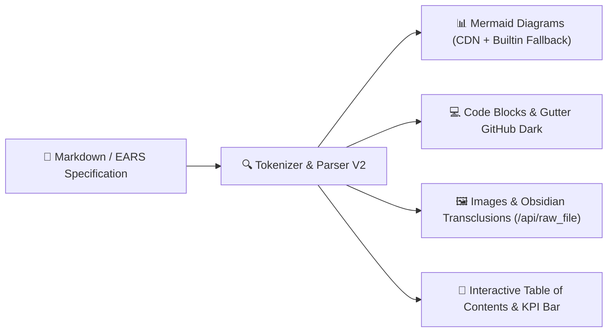
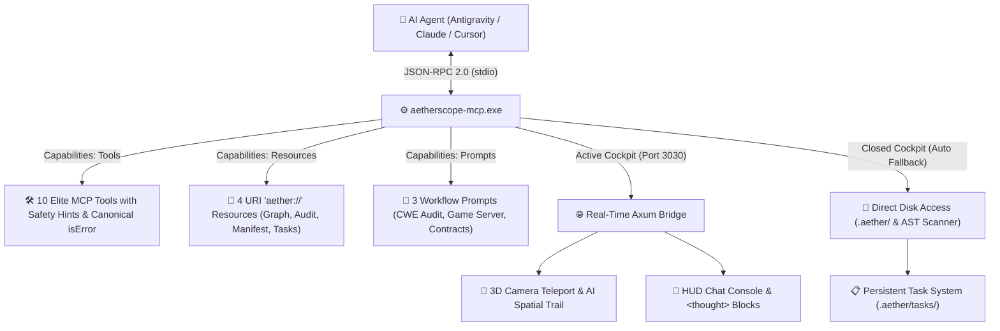

<div align="center">

# 🪐 AetherScope V2 (`aether-engine`)

### **WebGL 2 Architectural Space Cockpit • Zero-Day SAST Linter (185+ Zero-Day Patterns & CWE Rules) • BLAKE3 Cryptographic Governance • Native MCP Server & "Zero-Shell" AI Gateway**

<p align="right">
  <b>English 🇬🇧</b> | <a href="./README.fr.md">Français 🇫🇷 (Version originale)</a>
</p>

[](https://maxxwwim.github.io/AetherScope-SAST-150-CWE-MCP/)
[](https://github.com/maxxwwim/AetherScope-SAST-150-CWE-MCP/releases)
[](https://www.rust-lang.org/)
[](https://www.khronos.org/webgl/)
[](https://modelcontextprotocol.io/)
[](https://m8ven.ai/mcp/maxxwwim-aetherscope-sast-150-cwe-blake3-serveur-mcp-visualiseur-de-co-j4mhm7?s=readme)
[](./CWE_CATALOG.md)
[](./CWE_CATALOG.md)
[](#-spec-driven-governance-ears-contracts--blake3-seal)
[](#-license)

<br/><br/>


</div>

---

## ⚡ What is AetherScope V2?

**AetherScope V2** is a next-generation software engineering environment and security audit cockpit merging **four foundational paradigms into a single native engine**:

| Engine DNA | What it supersedes / transcends | What AetherScope V2 delivers |
| :--- | :--- | :--- |
| 🌌 **1. Living Spatial Graph** *(Obsidian DNA)* | Slow static graphs, frozen UML diagrams | **Interactive 2D/3D galaxy running at 120 FPS** (WebGL 2 SDF Shaders), organic 12-lobed cellular membranes, 4 mathematical layouts, Coulomb/Hooke physics simulation, and procedural Web Audio. |
| 🛡️ **2. SAST Scanner & Bug Bounty** *(Zero-Day Audit DNA)* | Slow CI/CD linters, massive false-positive noise | **Real-time static audit (< 50 ms on each `Ctrl+S`)** powered by **185+ Zero-Day Patterns & CWE Rules** (Rust/LLVM/UB, PHP Web & API, Zig Systems & C-ABI, C# / ASP.NET Core, Smart Contracts & Distributed VMs, DeFi, ZK-SNARKs, Python, Node/V8, C/C++), anti-false-positive lexical masking, typed CWE routing, and **Interactive Bug Bounty Scope & PoC Generator**. |
| 🏛️ **3. "Spec-Driven" IDE Cockpit** *(Governance DNA)* | Outdated docs, architectural drift | Every folder owns its `README.md` contract (**EARS** rules, line budgets, allowed/forbidden imports) **cryptographically sealed with BLAKE3** in `aether.lock.toml`. Any transgression triggers an instant red laser alarm. |
| 🤖 **4. Native MCP Server & "Zero-Shell" AI Gateway** *(Copilot Console DNA)* | LLM context loss, destructive file rewrites, hallucinations | **Native MCP Server (`aetherscope-mcp.exe`)** + **`<aether_handshake>` packets**. AI agents (Antigravity, Claude, Cursor) teleport the 3D camera to target bubbles, maintain tasks in `.aether/tasks/`, and apply surgical diffs with zero context degradation. |

---

## 📌 Executive Table of Contents

1. [⚡ What is AetherScope V2?](#-what-is-aetherscope-v2)
2. [📖 What's New in V2.2.2: GitHub-Grade Markdown Engine, Interactive Mermaid Diagrams, Syntax Highlighting & Diff, Binary Raw File API & Reading KPI Bar](#-whats-new-in-v222-github-grade-markdown-engine-interactive-mermaid-diagrams-syntax-highlighting--diff-binary-raw-file-api--reading-kpi-bar)
3. [🧬 What's New in V2.2.1: Zig & C#/.NET Support, Community Semgrep, SSA Dataflow, Reachable SCA & Obsidian Vault Mode](#-whats-new-in-v221-zig--cnet-support-community-semgrep-ssa-dataflow-reachable-sca--obsidian-vault-mode)
4. [🚀 Major SAST Features in V2.1 (Production Ready)](#-major-sast-features-in-v21-production-ready)
5. [🚀 Quick Start, CLI & Local REST API](#-quick-start-cli--local-rest-api)
6. [🛡️ SAST Engine, Zero-Day Hunting & 185+ CWE Rules Catalog](#-sast-engine-zero-day-hunting--185-cwe-rules-catalog)
7. [🤖 Native MCP Server (`aetherscope-mcp`) & "Zero-Shell" AI Bridge](#-native-mcp-server-aetherscope-mcp--zero-shell-ai-bridge)
8. [🔒 "Spec-Driven" Governance, EARS Contracts & BLAKE3 Seal](#-spec-driven-governance-ears-contracts--blake3-seal)
9. [🏛️ Global Architecture & Cargo Workspace Structure](#-global-architecture--cargo-workspace-structure)
10. [🎨 WebGL 2 GPU Cockpit: Membranes, Bubbles, Lasers & Layouts](#-webgl-2-gpu-cockpit-membranes-bubbles-lasers--layouts)
11. [🛠️ Integrated IDE Tooling, Multi-Stack Scaffolding & Export](#-integrated-ide-tooling-multi-stack-scaffolding--export)
12. [🕹️ Keyboard Shortcuts, Compilation & Licensing](#-keyboard-shortcuts-compilation--licensing)
13. [📄 License](#-license)
14. [📚 Detailed CWE Rules List (Dedicated Directory)](./cwe/)

---

## 📖 What's New in V2.2.2: GitHub-Grade Markdown Engine, Interactive Mermaid Diagrams, Syntax Highlighting & Diff, Binary Raw File API & Reading KPI Bar

The left-side documentation inspection panel (`#doc-reader-panel`) has been completely overhauled in **V2.2.2** to deliver a **1:1 GitHub-identical** specification and reading experience while remaining 100% functional offline:



### 1. 📊 Official Mermaid Diagrams (Flowcharts, Sequences, Classes, State Machines)
- **Official Mermaid.js v10 Engine (CDN):** Direct interactive SVG vector rendering for ````mermaid```` code blocks.
- **Built-in Standalone Visual Fallback:** When working completely offline or before CDN initialization, an embedded visual tokenizer takes over, translating graph declarations (`-->`), classes, and sequences into interactive spatial CSS cards.
- **Dedicated Diagram Toolbar:**
  - `📋 Copy`: Instant one-click copy of Mermaid raw code to clipboard.
  - `👁️ Code / Render`: Seamless toggle between rendered SVG and raw diagram source.
  - `🔍 Fullscreen`: High-definition modal zoom with backdrop blur and responsive scaling.

### 2. 💻 GitHub Dark Syntax Highlighting & Code Interpretation
- **Official GitHub Dark Theme:** Token palette matching GitHub's official syntax theme (keywords `#ff7b72`, functions/classes `#d2a8ff`, literals/numbers `#79c0ff`, strings `#a5d6ff`, comments `#8b949e`, built-ins `#ffa657`).
- **Highlight.js CDN + Embedded Offline Regex Engine:** Instant high-speed highlighting across 14+ major programming languages (**Rust, Python, JavaScript, TypeScript, Bash/Shell, PowerShell, JSON, TOML, YAML, Diff, HTML, SVG, SQL, Zig, C#**) even without an active internet connection.
- **Line Numbers (GitHub Gutter `.doc-code-gutter`):** Clean line numbering column with unselectable numerals (`user-select: none`).
- **Surgical Copy Without Line Numbers:** The `📋 Copy` button copies only clean code, animating to `✅ Copied!` for 2 seconds with toast notification.
- **Special Git Diff Formatting:** ````diff```` blocks feature line-by-line GitHub highlighting (additions `+` in translucent green `#aff5b4`, deletions `-` in translucent red `#ffdcd7`, metadata `@@` in cyan).
- **Interactive Preview for HTML & SVG:** `👁️ Preview` button to toggle live component rendering in an isolated viewport.

### 3. 🖼️ Binary Raw File Endpoint `/api/raw_file` & Local Images
- **Local Media Support:** Direct rendering for relative project images (`./assets/diagram.png`, `images/schema.svg`, etc.) and remote shields.io badges.
- **Obsidian Wiki-Transclusions:** Seamless resolution of Obsidian transclusion syntax `![[image_name.png]]` routed automatically through `/api/raw_file`.
- **Automatic MIME Detection:** Proper content-type headers for `image/png`, `image/svg+xml`, `image/jpeg`, `image/webp`, and `text/plain`.

### 4. 📑 Interactive Table of Contents (TOC), KPI Metrics Bar & Search
- **Header KPI Bar:** Real-time reading time estimation (200 words/min), word count, line count, diagram count, image counter, EARS / BLAKE3 cryptographic seal indicator, and clickable absolute path.
- **Collapsible Hierarchical TOC:** Auto-generated from markdown headings `#` through `######` with smooth anchor jumps (`scrollToHeading`).
- **Instant Document Search:** Filter bar with occurrence highlighting and previous/next navigation (▲ / ▼).
- **Dynamic Panel Width Toggle:** `↔️ Width` button cycling the documentation panel through Standard (520px) ➔ Wide (880px) ➔ Fullscreen (95vw).

---

## 🧬 What's New in V2.2.1: Zig & C#/.NET Support, Community Semgrep, SSA Dataflow, Reachable SCA & Obsidian Vault Mode

### 1. 📓 Obsidian Vault Mode & Dual-Vision Cockpit (`crates/obsidian-vault`)
- **Automatic Tri-Mode Detection & Classification:** Automatically classifies the scanned directory:
  - **`PureObsidianVault`**: Pure markdown vault (`.obsidian/` folder or high density of wikilinks, 0 code) — defaults to Vault Notes view.
  - **`PureCode`**: Classic code project (Rust, C#, Zig, PHP, Python, etc.) — defaults to Code Architecture view.
  - **`Mixed`**: Hybrid directory combining source code and Obsidian knowledge base — **provides both views with instant real-time toggling**.
- **Markdown Parser & Comprehensive Obsidian Syntax (`parser.rs`):**
  - **Wikilinks & Aliases:** `[[note]]`, `[[note|custom alias]]`, resolved by relative path and file stem.
  - **Section Anchors & Block Refs:** `[[note#Section Title]]`, self-anchors `[[#Title]]`, and block references `[[note#^block-id]]`.
  - **Transclusions & Media Inclusions:** `![[Diagram.png]]`, `![[Note#Section]]` generating render edges (`EdgeType::Render`).
  - **Hierarchical Tags & YAML Frontmatter:** Inline tags `#tag`, `#project/roadmap`, YAML metadata attributes (`tags: [...]`, `aliases: [...]`) with strict masking of code blocks and CommonMark comments.
  - **Backlinks & Ghost Notes:** Automatic bidirectional degree calculation (`in_degree`, `out_degree`) and creation of «GhostNote» bubbles for uncreated reference links.
- **Security & Strict Confinement (`confinement.rs` — Zero CWE-22 Path Traversal):**
  - `PathGuard` module and `TargetJail`: strict rejection of directory traversals (`..`), UNC network paths (`\\server\share`), drive letters (`C:\Windows`), null bytes (`\0`), and symlinks pointing outside the project root.
- **Real-Time Dual-Vision WebGL 2 Switcher:**
  - View switcher in the top `#serverbar` and *Vision* menu with shortcuts <kbd>Alt</kbd> + <kbd>1</kbd> (Code) and <kbd>Alt</kbd> + <kbd>2</kbd> (Vault Notes).
  - Smooth topology swap without page reload via `POST /api/view_mode` and off-thread GPU physics refresh.
  - **Dual-Vision Standalone Export:** Standalone HTML exports (`aetherscope_viewer.html` and `docs/index.html`) embed both graphs (`window.__AETHERSCOPE_DUAL_GRAPH__`) for full offline toggling.

### 2. ⚡ Native Zig Support (`ast-scanner` + 15 CWE Rules + Taint Tracking)
- **Zig AST Extraction & Lexer (`scanner.rs`, `lexer.rs`):** Parallel parsing for `struct`, `packed struct`, `extern struct`, `union(enum)`, `error`, `pub fn`, `@import`, and `@cImport`, with lexical masking of multiline strings `\\` and automatic truncation of `test "..." {}` blocks.
- **15 Zig SAST Rules (`zig_rules.rs`):**
  - **Memory & Pointers:** `CVE-ZIG-USE-AFTER-FREE` (`CWE-416`), `CVE-ZIG-RAW-ALLOCATOR-LEAK` (`CWE-401`), `CVE-ZIG-STACK-ADDRESS-RETURN` (`CWE-562`), `CVE-ZIG-UNINITIALIZED-MEMORY` (`CWE-457`), `CVE-ZIG-INSECURE-POINTER-CAST` (`CWE-843`).
  - **Arithmetic, SIMD & Compiler:** `CVE-ZIG-INTEGER-OVERFLOW-WRAPPING` (`+%`/`-%`/`*%`, `CWE-190`), `CVE-ZIG-SIMD-VECTOR-UNALIGNED-OOB` (`@Vector`, `CWE-125`), `CVE-ZIG-RUNTIME-SAFETY-DISABLED` (`@setRuntimeSafety(false)`, `CWE-676`), `CVE-ZIG-UNHANDLED-ERROR-UNION` (`_ = fallible()`, `CWE-703`).
  - **C-ABI Interoperability, OS & Crypto:** `CVE-ZIG-BUFFER-OVERRUN-C-INTEROP` (`CWE-119`), `CVE-ZIG-UNPROTECTED-C-FORMAT-STRING` (`CWE-134`), `CVE-ZIG-COMMAND-INJECTION` (`std.process.Child`, `CWE-78`), `CVE-ZIG-PATH-TRAVERSAL` (`CWE-22`), `CVE-ZIG-TLS-VERIFY-DISABLED` (`CWE-295`), `CVE-ZIG-WEAK-PRNG-CRYPTO` (`DefaultPrng`, `CWE-338`).

### 3. 🔷 Native C# / .NET 8+ Support (`ast-scanner` + 20 CWE Rules + Taint Tracking)
- **C# AST Extraction & Lexer (`scanner.rs`, `lexer.rs`):** File-scoped and block `namespace`, `class`, `record`, `struct`, `interface`, properties, `async`/`Task<T>` methods, ASP.NET Core endpoints (`[HttpGet]`, `[HttpPost]`, `[Route]`, Minimal APIs `app.MapGet`/`MapPost`), with verbatim `@"..."` and raw string `"""..."""` masking.
- **20 C# / .NET SAST Rules (`csharp_rules.rs`):**
  - **Injections & RCE:** `CVE-CS-INSECURE-DESERIALIZATION` (`BinaryFormatter`/`TypeNameHandling`, `CWE-502`), `CVE-CS-SQL-INJECTION` (`SqlCommand`/`ExecuteSqlRaw`/Dapper, `CWE-89`), `CVE-CS-COMMAND-INJECTION` (`Process.Start`, `CWE-78`), `CVE-CS-UNSAFE-REFLECTION-INVOKE` (`Type.GetType`/`CSharpScript`, `CWE-470`), `CVE-CS-XXE-INJECTION` (`CWE-611`), `CVE-CS-LDAP-INJECTION` (`CWE-90`).
  - **Web, API & ASP.NET Core:** `CVE-CS-SSRF-HTTPCLIENT` (`CWE-918`), `CVE-CS-XSS-RAW-HTML` (`Html.Raw`/`HtmlString`, `CWE-79`), `CVE-CS-OPEN-REDIRECT` (`CWE-601`), `CVE-CS-MASS-ASSIGNMENT` (`TryUpdateModelAsync`, `CWE-915`), `CVE-CS-CSRF-DISABLED` (`[IgnoreAntiforgeryToken]`, `CWE-352`), `CVE-CS-PATH-TRAVERSAL` (`CWE-22`), `CVE-CS-SENSITIVE-ERROR-EXPOSURE` (`ex.StackTrace`, `CWE-209`).
  - **Auth, Crypto & Runtime:** `CVE-CS-JWT-VALIDATION-BYPASS` (`TokenValidationParameters`, `CWE-347`), `CVE-CS-TLS-CERT-BYPASS` (`DangerousAcceptAnyServerCertificateValidator`, `CWE-295`), `CVE-CS-HARDCODED-CREDENTIALS` (`CWE-798`), `CVE-CS-WEAK-CRYPTOGRAPHY` (`MD5`/`SHA1`/`DES`/`ECB`, `CWE-327`), `CVE-CS-INSECURE-RANDOM` (`System.Random`, `CWE-330`), `CVE-CS-REDOS-UNBOUNDED-REGEX` (`CWE-1333`), `CVE-CS-UNSAFE-STACKALLOC-OVERFLOW` (`stackalloc`, `CWE-787`).

### 4. 🧬 Community Semgrep Rules (100% Offline, No Cloud Account Required)
- **22 OWASP Top 10 / CWE Top 25 Rules** compiled directly into the binary (`community_owasp_cwe.yaml`, `community_bundle.rs`), active upon first startup.
- **On-Demand Synchronization** & hot-reload in `.aether/plugins/`:
  ```bash
  aether-plugin-tool.exe download-semgrep-rules --output .aether/plugins
  aether-plugin-tool.exe download-semgrep-rules --offline
  aether-plugin-tool.exe import-semgrep --input ./semgrep-rules --output .aether/plugins/imported
  ```

### 5. 🔗 Inter-Procedural SSA Dataflow Taint Tracking
- Dedicated `crates/core-graph/src/dataflow/` module: exact variable versioning (`SsaVar`), def-use chains, inter-procedural propagation, and cycle-resistant traversals.
- **CWE-Specific Sanitizer Catalog (`sanitizer_catalog.rs`):** Data filtered through `sanitize(x)` will not trigger a Sink alert. Unsanitized flows produce complete propagation traces.

### 6. 📦 Reachable Dependencies SCA (OSV.dev)
- Native parsers for `Cargo.lock`, `package-lock.json`, and `composer.lock` (`crates/security-linter/src/sca/`).
- OSV.dev queries with **BLAKE3-signed persistent disk caching**: full offline scanning capability following initial synchronization.
- Cross-referencing with call graphs: only vulnerable dependencies whose functions are **directly reached from an Entrypoint** are flagged as reachable.

---

## 🚀 Major SAST Features in V2.1 (Production Ready)

### 1. Standard SARIF v2.1.0 Serializer (OASIS & GitHub Code Scanning)
- **Native SARIF 2.1.0 Generation:** Implemented in `crates/security-linter/src/sarif.rs`, fully compatible with **GitHub Security / Code Scanning Alerts**.
- **Ultra-Fast CI/CD CLI:**
  ```bash
  # Generate a standard SARIF report
  aether-engine.exe --path . --audit-only --format sarif --output results.sarif

  # Block Pull Requests in < 100 ms if critical or high vulnerabilities are found
  aether-engine.exe --path . --audit-only --format sarif --output results.sarif --fail-on HIGH
  ```
- **Turnkey GitHub Actions Workflow:** Pre-configured `.github/workflows/aetherscope-sarif.yml` included.

### 2. Reachability 3D Taint-Graph (Source-to-Sink)
- **Reverse BFS Algorithm:** High-speed graph traversal in `crates/core-graph/src/reachability.rs` connecting every CVE Sink to public entrypoints (`SymbolKind::FormOrEndpoint`) through RPC, WebSocket, and semantic call pathways.
- **3D WebGL 2 Visualization:** `🔥 EXPLOITABLE (Source-to-Sink)` badge in the inspector and **continuous pulsating red laser** illuminating the full `Endpoint -> Handler -> Service -> Sink` trajectory upon selection.

### 3. Universal Semgrep & Nuclei Rule Converter
- **Automated YAML Translation:** `crates/security-linter/src/semgrep_importer.rs` converts metavariables `$X` and ellipses `...` into high-performance native Rust regular expressions.
- **CLI Import Command:**
  ```bash
  aether-plugin-tool.exe import-semgrep --input ./semgrep-rules/ --output .aether/plugins/imported/
  ```

### 4. Real-Time AI Guardrail Firewall (`aetherscope_verify_patch`)
- Enables autonomous agents (Claude, Cursor, Antigravity) to test proposed code modifications in **< 50 ms** before writing to production files:
  - Incremental SAST scan + Source-to-Sink reachability check
  - Strict verification of folder EARS contracts (`RULE_FORBIDDEN_IMPORT`, `RULE_MAX_LINES`, `BLAKE3_TAMPERED`)
  - Certified verdict: `[PATCH_APPROVED]` or `[PATCH_REJECTED]` with automatic 3D camera focus.

### 5. Reproducible High-Frequency Benchmark Harness
- **`--benchmark` CLI Flag:** Measures lexing duration, multithreaded AST construction (Rayon), 150+ CWE evaluation, peak RSS RAM consumption, and LOC/sec processing speed.
  ```bash
  aether-engine.exe --benchmark
  ```
- Automated benchmark report output to [`BENCHMARK.md`](./BENCHMARK.md) (Measured throughput: **4,446 LOC/second**, Peak RAM: **27.5 MB**).

---

## 🚀 Quick Start, CLI & Local REST API

### 🚀 1-Click Windows Utilities

AetherScope V2 includes ready-to-run scripts at root and inside distribution archives:

- **`Start-Cockpit.bat`:** Instant double-click launch. Terminates stale processes holding port `3030` and fires up the 3D WebGL Cockpit.
- **`AetherScope-Launcher.bat`:** Interactive terminal launcher with menu options (Cockpit, Headless Server, CLI SAST scan, Port cleanup, MCP configuration).
- **`setup-mcp.ps1`:** Automatically detects and configures the MCP server in **Claude Desktop**, **Cursor**, and **Antigravity / Gemini** without manual JSON editing.
- **`install.ps1`:** Installs binaries into `%LOCALAPPDATA%\AetherScope\bin`, registers commands in the system `PATH`, and places a desktop shortcut.

---

### Command Line Options (CLI)

```powershell
# Launch Desktop WebGL 2 Cockpit + Axum Server + FileWatcher (Default Mode)
.\target\release\aether-engine.exe --path "C:\Path\To\Project" --port 3030

# Headless SAST/AST audit only (generates .aether/LIVE_AUDIT.md and exits)
.\target\release\aether-engine.exe --path "C:\Path\To\Project" --audit-only

# Run Axum Server + FileWatcher in the background without opening a GUI window
.\target\release\aether-engine.exe --path "C:\Path\To\Project" --no-gui

# Run the MCP Server in JSON-RPC 2.0 stdio mode
.\target\release\aetherscope-mcp.exe --port 3030
```

---

### 🌐 Local REST API Endpoints (24 Routes — `http://127.0.0.1:3030`)

The embedded Axum server serves the spatial cockpit at `GET /` and coordinates real-time synchronization with audit subsystems:

| Method & Route | Technical Function |
| :--- | :--- |
| `GET /` | **Root Route:** Serves the WebGL 2 cockpit bundle with initial topology. |
| `GET /api/health` | Engine health probe (`{"status":"ok","engine":"aether-v2"}`). |
| `GET /api/graph` | Returns the complete `AetherGraph` (nodes, edges, layouts, CVE anomalies). |
| `GET /api/graph/version` | Atomic counter updated by FileWatcher for zero-latency hot reloads. |
| `GET` / `POST /api/analyze` | Triggers AST + SAST analysis for a target project path with exclusions. |
| `GET /api/projects` | Discovers available candidate projects in workspace. |
| `GET` / `POST /api/workspace` | Reads or updates the active workspace directory. |
| `POST /api/dialog/pick_workspace`| Opens native OS folder picker to select a multi-project workspace. |
| `POST /api/dialog/pick_project` | Opens native OS folder picker to load a single project directory. |
| `POST /api/init_project` | Scaffolds a complete multi-stack architectural skeleton (`rust`, `python`, `ts`, `hybrid`). |
| `POST /api/contracts/sign` | Calculates and seals BLAKE3 fingerprints for `README.md` files into `aether.lock.toml`. |
| `POST /api/save_doc` | Saves Markdown documentation and automatically reseals its BLAKE3 contract. |
| `GET /api/file_content` | Lazy-loads raw file or `README.md` contents on demand. |
| `GET /api/raw_file` | **[New v2.2.2]** Serves binary files (PNG, SVG, JPG, WebP) and markdown assets with proper MIME types. |
| `POST /api/ai/target` | Writes `.aether/ACTIVE_TARGET.md` and returns `<aether_handshake version="2.0">`. |
| `GET` / `POST /api/ai/telemetry` | Reads or emits AI spatial telemetry events (camera teleport & beacon). |
| `GET` / `POST /api/ai/chat` | Retrieves or posts messages in the Copilot Chat Console. |
| `POST /api/ai/chat/clear` | Clears cockpit conversation history. |
| `POST /api/ai/cancel` | Aborts ongoing AI generation. |
| `POST /api/ai/new_session` | Starts a fresh Copilot session. |
| `GET /api/ai/system_prompt` | Generates stack-optimized system prompts based on detected technologies. |
| `POST /api/ai/create_file` | Writes source file to disk, rescans graph, and triggers a Supernova visual burst. |
| `GET` / `POST /api/tasks` | Lists or creates persistent tasks in `.aether/tasks/`. |
| `POST /api/tasks/update` | Updates task status, progress (`0-100%`), and mini-`README.md`. |
| `POST /api/tasks/delete` | Deletes a task and updates `.aether/TASKS_SUMMARY.md`. |
| `GET` / `POST /api/settings` | Reads or saves exclusion rules and granular activation for 185+ CWE rules. |
| `POST /api/export` | Exports interactive graph into a self-contained `aetherscope_viewer.html` file. |
| `GET /api/project/status` | Project classification report (`PureObsidianVault`, `PureCode`, `Mixed`, active view mode). |
| `POST /api/view_mode` | Switches active graph topology (`"code"` or `"vault"`) without reloading page. |

---

## 🛡️ SAST Engine, Zero-Day Hunting & 185+ CWE Rules Catalog

### Anti-False-Positive Lexical Masking, Typed CWE Routing & Bug Bounty Scope Hub

Unlike naive regex-based scanners that produce overwhelming noise on comments and test files, AetherScope V2 incorporates:

1. **Dual-Pass Multi-Language Lexer (`lexer.rs`):** Automatically masks comments (`//`, `/* */`, `#`, docstrings) and string literals before evaluating syntax rules, while truncating inline unit test modules (`#[cfg(test)]`, `mod tests`).
2. **Typed CWE Routing (`matches_file` & `get_file_types_for_cwe`):** Eliminates 100% of cross-language false alerts using file extension scoping. 25 PHP rules target `.php`, 15 Zig rules evaluate `.zig`, 20 C# rules evaluate `.cs`, Rust rules analyze `.rs`, and C/C++ targets `.c`/`.cpp`.
3. **Bug Bounty Scope Preparer & PoC Generator (`🎯 Scope / PoC Bug Bounty`):**
   - Visual toggle for **✅ IN-SCOPE** and **🚫 OUT-OF-SCOPE** directories with presets (*PHP Web & API*, *Zig Systems & C-ABI*, *C# / ASP.NET Core*, *L1 Consensus*, *Web3 DeFi*, *Rust Low-Level*).
   - **3 Audit Prompt Generation Modes:**
     - 🧪 **Mode 1 — Triage & Executable PoC (Zero code modifications):** Enforces surgical bug triage, tests reachability, and crafts standalone exploits (`#[test]`, Python/curl, `cargo miri`, Foundry `test_poc`) formatted for **Immunefi / HackerOne / Cantina**.
     - 🔬 **Mode 2 — Low-Level Zero-Day Hunting:** Targets compiler subtleties, stack unwinds, FFI ABI mismatches, and state desynchronizations.
     - 🛡️ **Mode 3 — Minimal Surgical Patch:** Produces certified gold-standard remediation patterns to fix vulnerabilities without collateral side effects.
4. **Flexible CWE Management & High Verbosity Handling (Java):**
   - **1-Click Ignore CWE Button:** Instantly ignore specific CWE rules directly from vulnerability cards with LocalStorage persistence and `/api/settings` synchronization.
   - **Java High-Verbosity Threshold (RULE_MAX_LINES / CWE-1075):** Adjusts line threshold to 10,000 lines for Java classes to accommodate normal framework boilerplate (Spring, JPA, DTOs).
5. **Declarative Hot-Reload Plugin Architecture (`aether-plugin-tool`):**
   - Define custom rules in YAML/JSON under `.aether/plugins/<plugin_name>/plugin.yaml` with **zero recompilation**.
   - Built-in test suites (`test_cases`) verifying zero false positives before deployment.

### 📚 185+ CWE Rules & Zero-Day Patterns Catalog

The detailed catalog across 13 security families (Rust/LLVM, Consensus & Wasm, Smart Contracts EVM, DeFi, ZK, MMO, Multi-Language Injections, Front-End/Node, EARS Architecture, C/C++, PHP, Zig, C# / .NET) is available at:

👉 **[`cwe/`](./cwe/)**: breakdown by security family • **[`CWE_CATALOG.md`](./CWE_CATALOG.md)**: official summary catalog.

---

## 🤖 Native MCP Server (`aetherscope-mcp`) & "Zero-Shell" AI Bridge

### JSON-RPC 2.0 Multi-Primitive Architecture (Tools, Resources, Prompts)

AetherScope V2 compiles a dedicated companion binary: **`aetherscope-mcp.exe`**, adhering to the official **Model Context Protocol (JSON-RPC 2.0 over `stdio` — version `2024-11-05`)** and verified according to **M8ven Protocol Compliance (Score 85+/100)**:



- **Mode 1 — Live Axum Bridge (Cockpit running):** Every MCP tool invocation drives the visual cockpit (3D camera teleportation, quantum beacon pulses, HUD chat messages, task progress bar animations).
- **Mode 2 — Direct Disk Fallback (Cockpit closed):** If GUI is closed, `aetherscope-mcp.exe` runs AST/SAST scanning directly and operates on `.aether/` files on disk. **No MCP call ever fails.**

---

### Curated 10 Elite MCP Tools (M8ven Compliance Score 100/100)

| MCP Tool | M8ven Safety Hints | Key Arguments | Operational Impact & Synchronization |
| :--- | :--- | :--- | :--- |
| **`aetherscope_get_graph_summary`** | `readOnlyHint: true`<br>`destructiveHint: false`<br>`idempotentHint: true` | `path?` | Returns global project topology: node counts, edges, folder distribution, health index, CVE tally, and Obsidian vault metrics. |
| **`aetherscope_get_active_target`** | `readOnlyHint: true`<br>`destructiveHint: false`<br>`idempotentHint: true` | `symbol_id` | Extracts targeted symbol context: code, docstring, categorized incoming/outgoing flows (UI, HTTP, WS, DB, Contracts, Calls), EARS rules, and linked tasks. |
| **`aetherscope_teleport_camera`** | `readOnlyHint: true`<br>`destructiveHint: false`<br>`idempotentHint: true` | `target`, `action`, `details` | **Teleports cockpit 3D camera** to target node, traces spatial breadcrumb trail, and updates telemetry display. |
| **`aetherscope_scan_project`** | `readOnlyHint: true`<br>`destructiveHint: false`<br>`idempotentHint: true` | `path?` | Triggers parallel AST rescan and SAST security evaluation (< 100 ms) and refreshes WebGL 2 graph. |
| **`aetherscope_create_task`** | `readOnlyHint: false`<br>`destructiveHint: false`<br>`idempotentHint: false` | `title`, `kind?`, `target_symbol?`, ... | Creates a persistent task directory under `.aether/tasks/<id>/` with `task.json` and mini-`README.md`. |
| **`aetherscope_update_task`** | `readOnlyHint: false`<br>`destructiveHint: false`<br>`idempotentHint: true` | `task_id`, `status?`, `progress?`, ... | Updates status (`pending`, `in_progress`, `blocked`, `done`), completion percentage `0-100%`, and task Markdown log. |
| **`aetherscope_list_tasks`** | `readOnlyHint: true`<br>`destructiveHint: false`<br>`idempotentHint: true` | `status_filter?` | Lists active/completed missions and updates `.aether/TASKS_SUMMARY.md`. |
| **`aetherscope_send_chat_message`** | `readOnlyHint: false`<br>`destructiveHint: false`<br>`idempotentHint: false` | `text`, `thought?`, `target_symbol?` | Sends technical debriefs or questions to cockpit **Copilot Chat Console**, supporting `<thought>` accordion foldouts. |
| **`aetherscope_get_chat_history`** | `readOnlyHint: true`<br>`destructiveHint: false`<br>`idempotentHint: true` | *(none)* | Reads message history for conversational continuity. |
| **`aetherscope_search_symbols`** | `readOnlyHint: true`<br>`destructiveHint: false`<br>`idempotentHint: true` | `query`, `layer?`, `kind?`, `limit?` | Ultra-fast symbol and Obsidian note search by name, regex, or stereotype (`«Note»`, `«GhostNote»`). |
| **`aetherscope_trace_flow`** | `readOnlyHint: true`<br>`destructiveHint: false`<br>`idempotentHint: true` | `symbol_id`, `direction?`, `max_depth?` | Traces upstream callers and downstream callee dependencies. |
| **`aetherscope_query_violations`** | `readOnlyHint: true`<br>`destructiveHint: false`<br>`idempotentHint: true` | `severity?`, `cwe_id?`, `file_pattern?` | Queries and filters project SAST security findings and CWE rules. |
| **`aetherscope_verify_patch`** | `readOnlyHint: true`<br>`destructiveHint: false`<br>`idempotentHint: true` | `files_modified` | Real-time AI patch firewall (< 50 ms): evaluates EARS contracts, lines limits, incremental SAST, Source-to-Sink reachability, and BLAKE3 signatures. |
| **`aetherscope_switch_view_mode`** | `readOnlyHint: false`<br>`destructiveHint: false`<br>`idempotentHint: true` | `mode` (`"code"` \| `"vault"`) | Instantly switches active cockpit topology between Code AST and Obsidian Vault Knowledge Graph. |

---

### Universal MCP Integration (`claude_desktop_config.json`, `mcp.json`)

Add this configuration to your MCP config file (`~/.gemini/config/mcp_config.json`, `.cursor/mcp.json`, or `claude_desktop_config.json`):

```json
{
  "mcpServers": {
    "aetherscope": {
      "command": "C:\\Path\\To\\aether-engine\\target\\release\\aetherscope-mcp.exe",
      "args": ["--port", "3030"]
    }
  }
}
```

---

## 🔒 "Spec-Driven" Governance, EARS Contracts & BLAKE3 Seal

To prevent architectural entropy (circular dependencies, I/O inside pure domain modules, bloated 3000-line files), each folder can hold a `README.md` contract with YAML frontmatter and **EARS** (*Easy Approach to Requirements Syntax*) rules:

```markdown
---
id: server-domain
layer: domain
max_lines_per_file: 200
allowed_imports: ["contracts::*"]
forbidden_imports: ["server/api::*", "client::*", "data-nodes::*"]
security_rules:
  no_raw_sql: true
  no_env_access: true
  deterministic_only: true
---
# 🏛️ Pure Business Logic (Domain)

## 🛡️ EARS Rules
- WHEN domain rule is evaluated THE SYSTEM SHALL execute deterministically without I/O.
- IF input nights exceed 90 THEN THE SYSTEM SHALL return a domain validation error.
```

1. **Continuous Evaluation (< 50 ms):** On every save, `security-linter` enforces file line limits (`RULE_MAX_LINES`), forbidden imports (`RULE_FORBIDDEN_IMPORT`), and environment access restrictions (`SAST_DIRECT_ENV_ACCESS`).
2. **BLAKE3 Cryptographic Seal (`aether.lock.toml`):** Fingerprints of all `README.md` contracts are locked in `aether.lock.toml`. If an agent modifies a contract without explicit authorization, the critical `BLAKE3_TAMPERED` alarm illuminates the graph in red.

---

## 🏛️ Global Architecture & Cargo Workspace Structure

AetherScope V2 is structured into **7 Rust crates** strictly decoupled according to Hexagonal Architecture:

```text
aether-engine/
├── Cargo.toml                              # Unified Cargo Workspace (Edition 2021, v2.2.2)
├── README.md                               # Primary documentation (English)
├── README.fr.md                            # Original documentation archive (Français)
├── AETHER_AI_RULES.md                      # System directives for autonomous AI agents
├── aether.lock.toml                        # Cryptographic BLAKE3 contract locks
├── .aether/                                # Real-time zero-shell file bridge (< 50 ms)
│   ├── LIVE_AUDIT.md                       # Live SAST audit report updated on every Ctrl+S
│   ├── ACTIVE_TARGET.md                    # Surgical context for selected symbol
│   ├── TASKS_SUMMARY.md                    # Markdown mission summary
│   └── tasks/                              # Persistent task records (Human & Agent)
│
├── apps/
│   └── aethercraft/                        # Autonomous application ecosystem & reference architecture
│
└── crates/
    ├── core-graph/                         # 1. Graph Data Model & Spatial Algorithms (Coulomb, Hooke)
    ├── ast-scanner/                        # 2. Multithreaded Polyglot AST Scanner (Rayon)
    ├── security-linter/                    # 3. SAST Engine, Lexer, EARS Contracts & BLAKE3 Seals
    ├── ai-file-bridge/                     # 4. Zero-Shell AI Bridge & Persistent Task Manager
    ├── arch-templates/                     # 5. Topology Hub & Multi-Stack Scaffolding
    ├── obsidian-vault/                     # 6. Obsidian Vault Engine & PathGuard Jail Confinement
    └── desktop-shell/                      # 7. Native Desktop Window (tao/wry) & MCP Stdio Server
        ├── src/main.rs                     # WebView2 GPU window & Axum server (port 3030)
        ├── src/mcp_main.rs                 # Standalone aetherscope-mcp.exe (JSON-RPC 2.0)
        ├── src/viewer.rs                   # Asset compiler & standalone HTML exporter
        └── assets/                         # Modular Frontend (Zero bulky frameworks, 100% native)
```

---

## 🎨 WebGL 2 GPU Cockpit: Membranes, Bubbles, Lasers & Layouts

### Dual-Layer Graphic Architecture & 3D Perspective Plane

To sustain steady **120 FPS** on graphs with thousands of nodes while rendering biological membranes and luminous lasers, AetherScope V2 superimposes two synchronized viewports:

1. **Primary WebGL 2 Canvas (Instanced GPU Background):**
   - Signed Distance Field (SDF) GLSL Shaders.
   - Starfields and neon halos rendered via a single instanced draw call (`gl.drawArraysInstanced`).
2. **Superimposed High-Definition 2D Canvas (Vector Foreground):**
   - **Tilted 3D Cybernetic Perspective Plane:**
     $$y_{3D} = y_{\text{world}} + (y_{\text{world}} - y_{\text{center}}) \times 0.35$$
   - Renders grid horizons, 12-lobed lipid bilayer membranes, affiliation lasers, and animated photons.

---

### ⚡ Off-Thread Physics Engine in Web Worker (Zero-Lag 120 FPS)

Since **v2.0.7**, AetherScope V2 moves simulation calculations off the main UI thread via a dedicated **Web Worker (`physics_worker.js`)**:
- **Off-Thread Vector Simulation:** Coulomb repulsion ($O(N^2)$), Hooke elastic attraction, and boundary confinement run asynchronously.
- **Zero-Copy Memory Transfers (`Transferable Float32Array`):** Updated `[x, y]` coordinates and lobe profiles transfer without memory allocation overhead.

---

### 4 Mathematical Layout Algorithms (`Z-1` to `Z-4`)

Toggle smoothly between 4 geometric topologies at 120 FPS via numeric keys <kbd>1</kbd>, <kbd>2</kbd>, <kbd>3</kbd>, <kbd>4</kbd>:

1. **Layout `Z-1` — Obsidian Galaxy (<kbd>1</kbd>):** Clusters arranged along **Fermat's Golden Spiral**:
   $$\theta = n \times 137.507764^\circ, \qquad r = c \sqrt{n}$$
2. **Layout `Z-2` — System Architecture (<kbd>2</kbd>):** Strictly aligned across **7 architectural layers**:
   `docs` ($-750\text{px}$) ➔ `ui` ($-580\text{px}$) ➔ `config` ($-380\text{px}$) ➔ `action` ($-220\text{px}$) ➔ `domain` ($+160\text{px}$) ➔ `utility` ($+380\text{px}$) ➔ `database` ($+540\text{px}$).
3. **Layout `Z-3` — DAG Execution Flow (<kbd>3</kbd>):** Left-to-right sequential stations:
   *UI Render* ➔ *Input/Trigger* ➔ *Domain Core* ➔ *Persistence*.
4. **Layout `Z-4` — UML Class & Contract Matrix (<kbd>4</kbd>):** Cartesian grid ($240\text{px} \times 120\text{px}$) ordering classes, structs, interfaces, and contracts.

---

## 🛠️ Integrated IDE Tooling, Multi-Stack Scaffolding & Export

### Omnibox Deep Search (`Ctrl+K`) & 4-Tab Inspector

- **Omnibox Deep Search (<kbd>Ctrl</kbd>+<kbd>K</kbd> or <kbd>/</kbd>):** Instant search across 8 categories (*All*, *Folders*, *Files*, *Classes/Structs*, *Functions*, *Endpoints*, *Docs*, *CVE Alerts*) with animated camera fly-to.
- **4-Tab Inspector (<kbd>I</kbd>):**
  1. **Debrief Tab:** LOC, McCabe complexity, In/Out degree, AST signatures, docstrings, and 1-click AI Handshake.
  2. **UML & Mini-DAG Tab:** Interactive vector SVG mini-graph and class structure map.
  3. **Relations Tab:** Categorized callers and callee dependencies.
  4. **CVE Anomalies Tab (`🚨`):** Vulnerability triage, attack vector breakdown, certified remediation, and 1-click PoC generator.

---

### Project Scaffolding Hub & Standalone Export

- **Project Hub (`🔨 Forge Architecture`):** Initializes clean hexagonal architectures across 4 stacks:
  1. 🦀 **Pure Rust** (Cargo Workspace, `RepositoryPort` traits, Serde DTOs).
  2. 🐍 **Pure Python (`uv`)** (Clean Monorepo, Pydantic v2 schemas, FastAPI, SQLAlchemy 2).
  3. 🟢 **Node.js / TypeScript (`pnpm`)** (End-to-end Zod validation, tRPC/Hono routers, Drizzle/Prisma).
  4. ⚡ **Hybrid Web3 & Real-Time MMO** (Binary WebSocket packets, Smart Contract ABIs, deterministic state).
- **Standalone HTML Export (`💾 Export Viewer`):** Compiles graph topology and WebGL 2 runtime into a single portable `aetherscope_viewer.html` file.
- **HD PNG Snapshot (<kbd>S</kbd>):** Captures high-resolution viewport image with contextual metadata watermark.

---

## 🕹️ Keyboard Shortcuts, Compilation & Licensing

### Cockpit Keyboard Shortcuts Map

| Key | Cockpit Action |
| :---: | :--- |
| <kbd>Ctrl</kbd> + <kbd>K</kbd> or <kbd>/</kbd> | **Omnibox Deep Search:** Instant search for folders, files, functions, classes, zero-day patterns & CWEs. |
| <kbd>1</kbd> / <kbd>2</kbd> / <kbd>3</kbd> / <kbd>4</kbd> | **Layouts `Z-1` to `Z-4`:** Switch between *Obsidian Galaxy*, *7-Layer System*, *DAG Flow*, and *UML Matrix*. |
| <kbd>Alt</kbd> + <kbd>1</kbd> | **Code AST Vision:** Switch cockpit view to software architecture graph. |
| <kbd>Alt</kbd> + <kbd>2</kbd> | **Obsidian Vault Vision:** Switch cockpit view to knowledge notes graph. |
| <kbd>F</kbd> | **Fit View:** Smoothly frame entire galaxy in viewport. |
| <kbd>X</kbd> | **X-Ray Focus Tunnel:** Isolate complete upstream/downstream causal chain for selected symbol. |
| <kbd>D</kbd> | **Dead Code Scanner:** Highlight unreachable orphan symbols ($	ext{in-degree} = 0$). |
| <kbd>H</kbd> | **Heatmap Mode:** Display project health score and complexity hotspots. |
| <kbd>G</kbd> | **Quantum Gravity:** Toggle Coulomb/Hooke physics simulation. |
| <kbd>I</kbd> | **Right Inspector:** Toggle 4-tab panel (Debrief, UML, Relations, Zero-Day & CWE). |
| <kbd>M</kbd> | **Left Markdown Reader:** Toggle `README.md` documentation panel. |
| <kbd>B</kbd> | **Left Synthesis Drawer:** Toggle module, layer, and vulnerability filters. |
| <kbd>C</kbd> | **Copilot Chat:** Open/close floating chat console. |
| <kbd>T</kbd> | **Tasks & Quests:** Open persistent missions modal (`.aether/tasks/`). |
| <kbd>A</kbd> | **HUD Telemetry:** Toggle AI spatial tracking banner. |
| <kbd>P</kbd> | **Preferences:** Configure labels, FPS, audio, exclusions, and active CWE rules. |
| <kbd>S</kbd> | **HD Snapshot:** Save high-resolution PNG screenshot. |
| <kbd>Esc</kbd> | Close active modal, exit specialized view mode, or deselect target. |

---

### Compilation & Build

#### Prerequisites
- **Rust 1.80+** (`cargo` and stable toolchain).
- **Windows 10 / 11** (Native WebView2 GPU runtime included with OS).

#### Build Commands
```powershell
# 1. Static check across all workspace crates
cargo check --workspace

# 2. Run unit and integration test suite
cargo test --workspace

# 3. Optimized release build
cargo build --release
```

#### Generated Binaries
- **Desktop Cockpit Binary:** `.\target\release\aether-engine.exe`
- **Native MCP Server Binary:** `.\target\release\aetherscope-mcp.exe`
- **Plugin CLI Tool:** `.\target\release\aether-plugin-tool.exe`

---

## 📄 License

This project is licensed under the **Source-Available Non-Commercial License ([PolyForm Noncommercial 1.0.0](LICENSE))**.

- ✅ **Free & Permitted:** Personal use, cybersecurity research, academic study, security audits, education, and open-source contributions.
- 🚫 **Strictly Prohibited without prior written agreement:** Commercial deployment, enterprise use, selling, bundling in proprietary products, or hosting as a commercial SaaS offering.

*For commercial licensing inquiries or partnerships: contact the author.*

[](https://m8ven.ai/mcp/maxxwwim-aetherscope-sast-150-cwe-blake3-serveur-mcp-visualiseur-de-co-j4mhm7?s=readme)

---

<p align="center">
  <b>English Version 🇬🇧</b> • <a href="./README.fr.md">Consulter la version originale française 🇫🇷</a>
</p>
