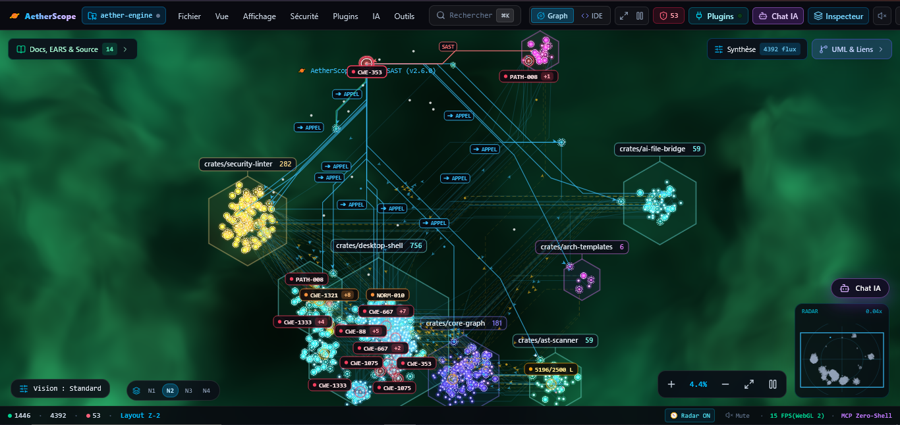

<div align="center">

<p align="center">
  
</p>

# 🪐 AetherScope / AetherSAST (v2.5.1)

### **Real-Time Static Application Security Testing (222 Native Rules + 24 Semgrep = 246 Rules) • SSA Taint Dataflow • Reachable SCA • BLAKE3 AST Cache (5.6x) & Cryptographic Governance • Ultra Path Guard & SecretGuard • WebGL 2 Spatial Cockpit & Full-Screen IDE • Native MCP Server**

<p align="right">
  <b>English 🇬🇧</b> | <a href="./README.fr.md">Français 🇫🇷 (Version originale)</a>
</p>

[](./CHANGELOG.md)
[](https://maxxwwim.github.io/AetherSAST-150-CWE-MCP/)
[](https://m8ven.ai/mcp/maxxwwim-aetherscope-sast-150-cwe-blake3-serveur-mcp-visualiseur-de-co-j4mhm7?s=readme)
[](https://www.rust-lang.org/)
[](./CWE_CATALOG.md)
[](https://www.khronos.org/webgl/)
[](https://modelcontextprotocol.io/)
[](./LICENSE)

</div>

---

## ⚡ Executive Summary

**AetherScope / AetherSAST** is an industrial-grade static application security testing (SAST), architectural intelligence engine, WebGL 2 spatial cockpit, and integrated multi-tab IDE built in 100% native Rust 2021. It combines real-time multi-language code analysis (<50ms per edit, with a persistent BLAKE3 AST cache for 5.6x faster rescans), cryptographic BLAKE3 governance contracts, inter-procedural SSA taint tracking, reachable dependency scanning (SCA), secret isolation (`SecretGuard`/`SecretMasker`), and a native Model Context Protocol (MCP) server for autonomous AI coding agents.

```
+---------------------------------------------------------------------------------------------------+
|                                 🪐 AETHERSCOPE / AETHERSAST v2.5.1                                |
+---------------------------------+---------------------------------+-------------------------------+
|    🛡️ ADVANCED SAST & SCA       |    🏛️ ARCHITECTURAL CONTRACTS   |    🤖 AI AGENT ORCHESTRATION  |
|  - 222 Native + 24 Semgrep Rules|  - EARS Syntax Requirements     |  - Native stdio MCP Server    |
|  - 28 Novel AETHER-* Detectors  |  - BLAKE3 Cryptographic Locks   |  - 10 Combined Tools          |
|  - --plugins & Taint/Window DSL |  - Folder & File Line Budgets   |  - Real-Time Patch Firewall   |
|  - SSA Dataflow & Reachable SCA |  - Orange / Red Visual Status   |  - Ultra Path Guard + Secrets |
|  - SARIF 2.1.0 CI/CD Exporter   |  - Integrated Multi-Tab IDE     |  - BLAKE3 AST Cache (5.6x)    |
+---------------------------------+---------------------------------+-------------------------------+
```

---

## 🛡️ 1. Real-Time SAST Engine & Security Intelligence

The core analysis engine in [`crates/security-linter`](./crates/security-linter/README.md) evaluates **222 native security rules** across 35 vulnerability families (including 28 non-CWE `AETHER-*` detectors) alongside **24 embedded Semgrep OWASP/CWE community rules** (**246 total rules**). Audits execute in parallel across 11 programming languages with a persistent **BLAKE3 AST cache (`5.6x` speedup)**, completing incremental checks in under 50 milliseconds upon every file modification.

### Key Capabilities

- **28 Exclusive Non-CWE Novel Detectors (`AETHER-*`)**: Implemented in `epic_novel_rules.rs` to detect stealth backdoors, compiler soundness anomalies, BiDi Trojan Source unicode tricks, async TLS context bleed, `rkyv` relative pointer exploits, and compile-time `build.rs` droppers.
- **Dual-Pass Lexical Comment & String Masking**: `lexer.rs` neutralizes comments and string literals prior to evaluating syntax patterns, preserving exact line numbers and byte offsets while preventing false-positive noise.
- **Specialized Multi-Stack Security Engines**:
  - **Systems & Memory Safety**: Rust/LLVM UB detection, panic safety across FFI/ABI boundaries, and Zig memory safety (15 rules: `@ptrCast`, SIMD unaligned OOB, error unions).
  - **Web & Enterprise**: PHP 8.x / WordPress (26 rules: dynamic includes, object injection, unescaped superglobals) and C# / .NET 8+ (20 rules: `BinaryFormatter`, XXE, ReDoS, `stackalloc`).
  - **Web3, DeFi & Cryptography**: Reentrancy, flash loan oracle manipulation, ERC-4337 paymaster griefing, ZK-SNARK Frozen Heart, and Circom unconstrained signals.
- **SSA Dataflow & Taint Propagation**: Inter-procedural Static Single Assignment (SSA) modeling in `core-graph` traces taint paths from untrusted sources to dangerous sinks, factoring in neutralizing sanitizers from `sanitizer_catalog.rs`.
- **Reachable Software Composition Analysis (SCA)**:
  - Scans `Cargo.lock`, `package-lock.json` (v1, v2, v3), and `composer.lock`.
  - Queries OSV.dev advisories with ecosystem normalization.
  - Operates 100% air-gapped via deterministic BLAKE3 cache in `.aether/cache/osv/` (`--offline-sca`).
  - Cross-references advisory functions against the AST call-graph to distinguish reachable, exploitable vulnerabilities from dormant dependencies.
- **SARIF v2.1.0 & CI/CD Quality Gates**: Fully compliant with OASIS SARIF v2.1.0 for native GitHub Code Scanning ingestion. CLI flag `--fail-on <CRITICAL|HIGH|MEDIUM>` halts CI/CD builds when thresholds are violated.
- **Real-Time AI Patch Firewall (`PatchVerifier`)**: Validates modified code in <50ms via `aetherscope_verify_patch`, blocking hallucinations, contract regressions, and introduced vulnerabilities before commit.

For an exhaustive listing of supported rules and remediation patterns, see the [CWE Catalog](./CWE_CATALOG.md).

---

## 🔒 2. "Spec-Driven" Architectural Governance & BLAKE3 Seals

AetherScope eliminates architectural drift through cryptographically sealed directory contracts. Every module folder maintains a `README.md` containing formal Easy Approach to Requirements Syntax (**EARS**) clauses and YAML frontmatter:

```yaml
---
id: domain-billing
layer: domain
max_lines_per_file: 400
file_max_lines:
  service.rs: 650
allowed_imports: ["core_graph::*", "serde::*"]
forbidden_imports: ["desktop_shell::*", "axum::*"]
security_rules:
  no_raw_sql: true
  no_env_access: true
---
```

### Cryptographic Sealing & Enforcement
1. **EARS Clauses**: Requirements formatted as `WHEN <trigger> THE SYSTEM SHALL <action>` are parsed into formal verification rules.
2. **Cryptographic Locking**: Contract hashes are committed to `aether.lock.toml`. Unauthorized manual tampering instantly raises `BLAKE3_TAMPERED` (`CWE-353`).
3. **1-Click Cockpit Sealing**: Update folder budgets (`max_lines_per_file`) or file overrides (`file_max_lines`) directly from the WebGL cockpit drawer; the backend re-signs `aether.lock.toml` via `/api/contracts/update`.
4. **Semantic Visual Warning Separation**:
   - 🟠 **Orange Architectural Warnings (`#f97316`)**: Line-budget breaches (`RULE_MAX_LINES` / `CWE-1075`) render as amber warnings and dashed links without inflating critical security counts.
   - 🔴 **Crimson Red Violations (`#ef4444`)**: Reserved strictly for actionable SAST/CWE flaws, boundary import violations (`RULE_FORBIDDEN_IMPORT`), and broken cryptographic seals.

---

## 🤖 3. Native Model Context Protocol (MCP) Server & AI Bridge

AetherScope provides a dedicated, native **Model Context Protocol (MCP)** server binary (`aetherscope-mcp.exe`) operating over standard I/O (`stdio`) via JSON-RPC 2.0 (specification `2024-11-05`), fully audited and scored 100/100 on M8ven Protocol criteria. It auto-detects if the backend is listening on port 3030 and automatically spawns a headless engine instance if needed.

### The 10 Consolidated MCP Tools

| Tool Name | Capabilities & Purpose |
| :--- | :--- |
| `aetherscope_get_graph_summary` | **4-in-1**: Project topology, Obsidian vault classification, active view mode, SAST violation counts, and task summaries. |
| `aetherscope_get_active_target` | **3-in-1**: 3D camera teleportation, EARS contract & AST docstring extraction, and upstream/downstream flow tracing. |
| `aetherscope_search_symbols` | **2-in-1**: Multi-criteria symbol/tag search across code and notes, SAST filtering, and Bug Bounty PoC scope scoping. |
| `aetherscope_switch_view_mode` | Toggles the active 3D visualization between `'code'` (AST topology) and `'vault'` (Obsidian knowledge graph). |
| `aetherscope_manage_tasks` | **4-in-1**: CRUD task management (`list`, `create`, `update`, `delete`) storing structured mini-specs in `.aether/tasks/`. |
| `aetherscope_verify_patch` | **<50ms AI Firewall**: Incremental SAST audit, contract line budget verification, and BLAKE3 integrity check on modified files. |
| `aetherscope_chat` | Bidirectional chat bridge with Cockpit Copilot HUD, swarm roster discovery, and `<thought>` section folding. |
| `aetherscope_manage_plugins` | Declarative YAML plugin management (`list`, `test`, `scan`, `upsert`) in `.aether/plugins/`. |
| `aetherscope_teleport_camera` | High-speed 3D WebGL camera navigation with quantum laser beam and breadcrumb trails. |
| `aetherscope_scan_project` | Standalone parallel rescan trigger refreshing the AST and graph models. |

### MCP Resources & Guided Prompts
- **5 URI Resources (`aether://*`)**: `aether://graph/summary`, `aether://audit/live`, `aether://contracts/manifest`, `aether://tasks/active`, `aether://agents/swarm`.
- **5 System Prompts**: `diagnostic_session_start`, `surgical_feature_workflow`, `audit_security_cwe`, `refactor_contract_violation`, `scaffold_game_server`.
- **Multi-Agent Swarm Telemetry**: Connect multiple AI agents simultaneously; each receives an assigned color badge from a 12-color hex palette, recording live actions in `.aether/ai_telemetry_cache.json`.

### MCP Client Configuration

Add this configuration to your Claude Desktop, Cursor, or Gemini agent settings:

```json
{
  "mcpServers": {
    "aetherscope": {
      "command": "C:\\path\\to\\aether-engine\\target\\release\\aetherscope-mcp.exe",
      "args": ["--port", "3030", "--path", "C:\\path\\to\\your-project"]
    }
  }
}
```

---

## 🌌 4. Spatial WebGL 2 Cockpit, Dual-Vision Mode & Full-Screen IDE

The desktop interface (`crates/desktop-shell`) hosts an ultra-responsive spatial engineering cockpit and integrated multi-tab IDE built with **Svelte 5 Runes** (`$state`), Tailwind CSS v4, and Vite 8:

- **120 FPS Instanced SDF Shader Rendering**: Custom WebGL 2 shaders render over 100,000 symbol nodes with organic 12-lobed cellular membranes, directional call/import chevrons, relation badges, sleek CWE pills, and luminous micro-star endpoints.
- **Infinite Dezoom Engine**: Zoom floor lowered to `0.00005` with vertex shader subpixel clamping (`screen_r >= 2.0px`), guaranteeing large codebases gleam like celestial star charts without disappearing.
- **Off-Thread Physics Simulation**: Dedicated Web Worker (`physics.worker.js`) executing Coulomb electrostatic repulsion and Hooke spring forces over zero-copy `Transferable Float32Array` buffers.
- **Dedicated Full-Screen Multi-Tab IDE**: Switch seamlessly to IDE mode with AST symbol hierarchy navigation, auto-open file at function on 3D bubble click, cosmic cluster-synchronized file-tree colors, integrated Doc/EARS/Source sidebars, resizable splitters, collapsible sidebars, Zen mode, and atomic file saving (`/api/save_file`).
- **Live AI (<5m) Left Dock & Workspace Explorer**: Real-time multi-agent activity dock with automatic 5-minute inactivity pruning plus built-in workspace filesystem explorer (`/api/fs/list`).
- **Dual-Vision Mode**: Instantly switch between **Code AST Architecture** and **Obsidian Knowledge Graph** (<kbd>Alt</kbd>+<kbd>1</kbd> / <kbd>Alt</kbd>+<kbd>2</kbd>).
- **4 Mathematical Layouts**:
  - `Z-1`: Fermat Spiral Galaxy layout.
  - `Z-2`: 7-Layer Structural Hierarchy (clean hexagonal architecture).
  - `Z-3`: Directed Acyclic Graph (DAG) dependency flow.
  - `Z-4`: UML Class & Matrix Grid layout.
- **Obsidian Vault Confinement**: Sandboxed ingestion in [`crates/obsidian-vault`](./crates/obsidian-vault/README.md) protected by `PathGuard` against CWE-22 path traversal and symlink escapes.

---

## 🏛️ 5. Workspace Topology & Core Crates

AetherScope is structured as a 7-crate Rust 2021 workspace adhering to clean hexagonal architecture:

```
                                    +-------------------------------------------------------+
                                    |     External AI Clients (Claude / Cursor / Gemini)    |
                                    +-------------------------------------------------------+
                                                                | JSON-RPC 2.0 (stdio)
                                                                v
                                    +-------------------------------------------------------+
                                    |     aetherscope-mcp.exe (MCP Server Stdio Process)    |
                                    +-------------------------------------------------------+
                                                                | HTTP (port 3030)
                                                                v
+---------------------------------------------------------------------------------------------------+
| desktop-shell (crates/desktop-shell)                                                              |
|   - Native Tao/Wry Window (WebView2)        - Axum REST Server (Port 3030, 40 Routes, LocalGuard) |
|   - Svelte 5 + WebGL 2 + Full-Screen IDE    - Network Surface Probers & Benchmark Harness         |
+---------------------------------------------------------------------------------------------------+
                                                                |
                                                                v
+---------------------------------------------------------------------------------------------------+
| Application & Action Layers                                                                       |
|   - obsidian-vault: PathGuard Jail (CWE-22), 4-Stage Project Classifier, Wikilink AST Parser      |
|   - ai-file-bridge: Zero-Shell FileWatcher (<50ms), PatchVerifier Firewall, TaskManager           |
|   - ast-scanner:    Rayon Polyglot AST Extractor (11 Langs), BLAKE3 AST Cache (5.6x), SecretGuard |
+---------------------------------------------------------------------------------------------------+
                                                                |
                                                                v
+---------------------------------------------------------------------------------------------------+
| Domain & Utility Layers                                                                           |
|   - security-linter: 222 Native + 24 Semgrep Rules, 28 AETHER-* Zero-Days, SecretGuard, SCA, SARIF|
|   - arch-templates:  Multi-Stack Scaffolder (Rust/Python/Node/Web3) & Pre-Signed EARS Contracts   |
|   - core-graph:      Pure Graph Domain, Z-1 to Z-4 Layouts, Reverse BFS, SSA Dataflow Taint       |
+---------------------------------------------------------------------------------------------------+
```

For complete technical documentation on each crate, inspect [`crates/README.md`](./crates/README.md) or direct crate guides:
- [`crates/core-graph`](./crates/core-graph/README.md)
- [`crates/security-linter`](./crates/security-linter/README.md)
- [`crates/arch-templates`](./crates/arch-templates/README.md)
- [`crates/ast-scanner`](./crates/ast-scanner/README.md)
- [`crates/obsidian-vault`](./crates/obsidian-vault/README.md)
- [`crates/ai-file-bridge`](./crates/ai-file-bridge/README.md)
- [`crates/desktop-shell`](./crates/desktop-shell/README.md)

---

## 🚀 6. Developer Getting Started & CLI Reference

### Prerequisites
- **Rust Toolchain**: 1.80+ (Stable)
- **C++ Build Tools**: MSVC on Windows (or build-essential on Linux)
- **WebView2 Runtime**: Included by default in Windows 10/11

### Quick Launch (Windows)
Double-click `Start-Cockpit.bat` or `AetherScope-Launcher.bat` to launch the native desktop cockpit.

### CLI Binary Reference

#### 1. `aether-engine` (Primary GUI & REST Backend)
```powershell
# Launch the desktop GUI cockpit (default port 3030)
cargo run -p desktop-shell --bin aether-engine -- -p .

# Headless SAST audit exporting SARIF 2.1.0 for CI/CD
cargo run -p desktop-shell --bin aether-engine -- --audit-only --format sarif -o results.sarif

# Headless audit with explicit plugin packs/profiles & CRITICAL failure gate
cargo run -p desktop-shell --bin aether-engine -- --audit-only --plugins all --fail-on CRITICAL

# Run standalone offline Software Composition Analysis (SCA)
cargo run -p desktop-shell --bin aether-engine -- --sca-only --offline-sca

# Run the performance benchmark harness
cargo run -p desktop-shell --bin aether-engine -- --benchmark
```

#### 2. `aetherscope-mcp` (Stdio Model Context Protocol Server)
```powershell
# Run the MCP server over stdio connected to local backend
cargo run -p desktop-shell --bin aetherscope-mcp -- --port 3030 --path .
```

#### 3. `aether-plugin-tool` (Declarative SAST Plugin Manager)
```powershell
# Unpack embedded Semgrep community bundle into .aether/plugins/
cargo run -p security-linter --bin aether-plugin-tool -- init-bundle .aether/plugins

# Translate Semgrep YAML rule into native Rust regex plugin
cargo run -p security-linter --bin aether-plugin-tool -- import-semgrep --input rule.yaml --output .aether/plugins/imported

# Run unit tests on all loaded YAML plugins
cargo run -p security-linter --bin aether-plugin-tool -- test .aether/plugins/
```

### Local Axum REST API Summary (40 Routes — Port 3030)
The embedded HTTP server binds exclusively to `127.0.0.1:3030` and is protected by `LocalGuard` (anti-DNS-rebinding/CSRF), `PathGuard` (CWE-22 confinement), and `SecretGuard` (sensitive file blocking). Key endpoints include:
- `GET /`: Serves the compiled Svelte 5 + WebGL 2 Cockpit & IDE.
- `GET /api/graph` & `GET /api/graph/version`: Slimmed `AetherGraph` topology and atomic version counter.
- `GET /api/files`, `GET /api/file_content`, `POST /api/save_file`, `GET /api/fs/list`: Confined IDE file listing, lazy content loading, atomic file saving, and workspace browsing.
- `POST /api/contracts/update` & `POST /api/contracts/sign`: Updates folder/file line budgets and re-seals `aether.lock.toml` with BLAKE3.
- `GET /api/git/status`: Live Git dirty files and security status correlation.
- `GET /api/raw_file`: Whitelisted binary media/doc streaming for Markdown & Obsidian embeds.
- `GET / POST /api/bounty/scope`: Bug Bounty scope recommendations and persistence.
- `POST /api/surface_scan`: Network attack surface audit and SSL/TLS analysis.
- `POST /api/view_mode`: Toggles between `'code'`, `'vault'`, and `'ide'` modes.

---

## 📄 7. License & Documentation Index

- **License**: Licensed under the [PolyForm Noncommercial License 1.0.0](./LICENSE).
- **Changelog**: Comprehensive milestone history from v2.0.0 through v2.5.1+ in [CHANGELOG.md](./CHANGELOG.md).
- **Vulnerability Catalog**: Complete breakdown of the 222 native rules (+ 24 Semgrep community rules) in [CWE_CATALOG.md](./CWE_CATALOG.md) and [`cwe/`](./cwe/README.md).
- **Performance Benchmark**: Automated throughput and memory metrics in [BENCHMARK.md](./BENCHMARK.md).
- **AI Directives**: System prompts, 10-tool MCP workflow, and SecretGuard protocol in [AETHER_AI_RULES.md](./AETHER_AI_RULES.md).
- **French Edition**: Original French reference documentation in [README.fr.md](./README.fr.md).
