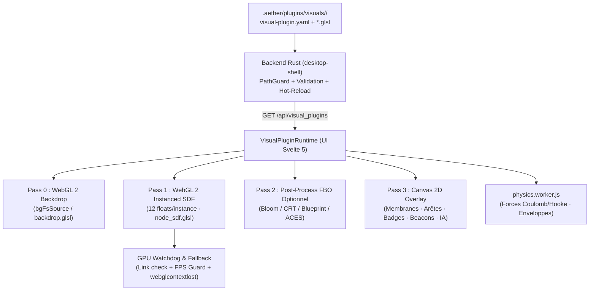

# 🌌 AetherScope — Spécification d’Architecture : Plugins Visuels WebGL 2

> **Statut** : **M1 + M2 Implémentés** (`v2.5.1+`) · M3 (`VisionLens` DSL + Post-Process FBO) en roadmap  
> **Objectif** : Permettre de personnaliser et d’étendre le rendu WebGL 2, les palettes, les modes de vision et la physique du graphe spatial AetherScope via des packs déclaratifs + shaders GLSL ES 3.00 sandboxés dans `.aether/plugins/visuals/<pack>/`, sans compromettre les 120 FPS ni la sécurité zéro-shell (`PathGuard`, CSP, zéro `eval()`).

---

## 1. Cartographie du pipeline de rendu existant

Le moteur de rendu dans `crates/desktop-shell/ui/src/engine/` est organisé en passes découplées :



| Module existant | Responsabilité actuelle | Extension plugin visuel |
| :--- | :--- | :--- |
| `shaders.ts` (`BackdropPipeline`) | Fond cosmique FBM nébuleuse + 2 couches d’étoiles | Uniforms dynamiques (`u_theme_colors[4]`, `u_params`) + hook GLSL `aetherBackdrop(...)` |
| `shaders.ts` (`ShaderPipeline`) | 4 formes SDF (`func`, `file`, `class`, `endpoint`), stride **10 floats** | Stride **10 → 12 floats** (`a_metric0`, `a_metric1`) + hook GLSL `aetherNodeSurface(...)` |
| `palette.ts` | Constantes `LAYER_COLORS`, `SEVERITY_COLORS`, `BRANCH_HUES` | Registre réactif surchargé par le pack visuel actif |
| `engine.ts` (`render()`) | 7 sous-passes Canvas 2D (`Scenery`, `Membranes`, `Edges`, `Labels`, `Git`, `Beacons`, `AI`) | Tokens de style (`organic_12lobe`, `hex_hull`, `rect_blueprint`, `orthogonal_pcb`) + primitives `VisionLens` |
| `physics.ts` + `physics.worker.js` | Simulation off-thread Coulomb/Hooke + enveloppes à 12 lobes | Paramètres de forces et géométrie transmis via `postMessage` |

---

## 2. Architecture en 4 Niveaux Progressifs

### Niveau 1 — Thèmes & Palettes Déclaratifs (`visual-plugin.yaml`)
- **Zéro code, zéro recompilation de shader** : surcharge des palettes de couches/sévérités, uniforms couleurs/densité du backdrop natif, style des membranes (`organic_12lobe` | `hex_hull` | `rect_blueprint` | `none`), style des arêtes (`bezier` | `straight` | `orthogonal_pcb`), polices et opacités.

### Niveau 2 — Shaders GLSL ES 3.00 Modulaires par « Hook Points »
AetherScope conserve un squelette hôte immuable (caméra, dezoom infini `screen_r >= 2.0px`, culling, spawn) et injecte uniquement les fonctions contractuelles fournies par le plugin :

1. **Extension du VBO d’instances (`10 → 12 floats / instance`)** :
   - Offsets `0..9` inchangés (`a_node_pos`, `a_radius`, `a_color`, `a_is_file`, `a_birth_time`, `a_git_status`).
   - Offset `10` : `a_metric0` (`[0..1]`, métrique principale de la lentille active : complexité, LOC, score CWE).
   - Offset `11` : `a_metric1` (`[0..1]`, signal secondaire : taint heat, degré, focus).
2. **Hook `backdrop.glsl`** : `vec3 aetherBackdrop(vec2 aspectUv, vec2 worldCam, float zoom, float timeSec)`
3. **Hook `node_sdf.glsl`** : `void aetherNodeSurface(in NodeCtx ctx, out vec3 rgb, out float alpha)`
4. **Hook `postprocess.glsl` (optionnel, désactivé en Mode Éco)** : `vec4 aetherPostProcess(sampler2D u_scene, vec2 uv, vec2 texel, float timeSec)` sur FBO hors-écran.

#### Garde-fous GPU & Sécurité
- **Validation statique Rust + TS** : taille max `32 Ko`/fichier, interdiction `#version`/`#extension` arbitraires, rejet des boucles `while` et plafonnement des boucles `for` constantes (anti-TDR / Shader DoS).
- **Hot-Swap Atomique** : le nouveau `WebGLProgram` est compilé et lié avant tout remplacement ; en cas d’erreur, le programme actif reste intact et l’erreur GLSL ré-indexée est remontée à l’UI.
- **Watchdog FPS** : si le temps de frame moyen dépasse `33 ms` (< 30 FPS) pendant 2 s après activation d’un shader custom, bascule automatique vers le pipeline natif avec notification.

### Niveau 3 — Lentilles de Vision Déclaratives (`VisionLens`) sans `eval()`
Permet à un pack de déclarer de nouveaux modes dans `VisionModesDeck.svelte` via un mini-évaluateur d’expressions typées pures (**zéro `eval()`, zéro `new Function()`, zéro `<script>` injecté dans le DOM WebView2**) :
- Propriétés en lecture seule sur `node` (`complexity`, `loc`, `cwe_count`, `has_security_violation`, `has_taint`, `in_degree`, `out_degree`, `layer`, `folder`, `git_status`, `is_dead_code`) et `edge` (`relation`, `is_violation`, `is_budget_warning`).
- Primitives vectorielles déclaratives (`pulsing_ring`, `orbit_badge`, `heat_aura`) rendues dans le Canvas 2D sans exposer le DOM ni `fetch('/api/save_file')`.

### Niveau 4 — Presets Physiques & Layouts (`physics.worker.js`)
Bloc `physics` optionnel dans `visual-plugin.yaml` (`layout_preset`, `repulsion_strength`, `spring_length_scale`, `cluster_gravity`, `damping`, `membrane_lobes`, `membrane_breath_amp`).

---

## 3. Exemple de Pack Visuel Complet

```text
.aether/plugins/visuals/cyber-pcb/
├── visual-plugin.yaml
├── backdrop.glsl
├── node_sdf.glsl
└── postprocess.glsl
```

```yaml
schema_version: 1
id: "cyber-pcb"
name: "Cyber-PCB Neon Blueprint"
version: "1.0.0"
enabled: true

palette:
  background: ["#040a0f", "#082f49", "#0e7490", "#06b6d4"]
  layers:
    ui: "#22d3ee"
    action: "#c084fc"
    domain: "#34d399"
    database: "#fbbf24"
    config: "#64748b"
    docs: "#818cf8"

overlay:
  membrane_style: "hex_hull"
  edge_style: "orthogonal_pcb"
  edge_pulse_speed: 1.6

shaders:
  backdrop: "backdrop.glsl"
  node_sdf: "node_sdf.glsl"
  postprocess: "postprocess.glsl"
  uniforms:
    grid_scale: 0.25
    bloom_intensity: 0.45

physics:
  repulsion_strength: 1.2
  membrane_lobes: 6
  membrane_breath_amp: 0.0

vision_lenses:
  - id: "pcb-voltage"
    label: "PCB Voltage"
    node_metric0: "clamp((node.in_degree + node.out_degree) / 25.0, 0.0, 1.0)"
    node_metric1: "node.cwe_count > 0 ? 1.0 : 0.0"
    node_opacity: "0.35 + 0.65 * clamp((node.in_degree + node.out_degree) / 10.0, 0.0, 1.0)"
```

---

## 4. Intégration & Feuille de Route

- **Backend (`desktop-shell`)** : `GET /api/visual_plugins`, `POST /api/visual_plugins/activate`, `POST /api/visual_plugins/upsert` confinés dans `.aether/plugins/visuals/` par `PathGuard` + ajout de l’extension `"glsl"` au `FileWatcherBridge` (`crates/ai-file-bridge/src/watcher.rs`) pour hot-reload GPU instantané.
- **Jalons** :
  - **M1 (Socle Déclaratif & Palettes)** : API `/api/visual_plugins`, surcharge `palette.ts`, uniforms dynamiques backdrop, styles membranes/arêtes, sélecteur UI + 3 packs intégrés (*Nebula*, *Blueprint*, *Cyber-PCB*).
  - **M2 (Shaders GLSL Hot-Swap & Stride 12)** : extension GPU `10 → 12 floats`, hook points `backdrop.glsl` / `node_sdf.glsl`, validateur GLSL anti-DoS, hot-swap atomique + Watchdog FPS.
  - **M3 (`VisionLens` DSL + Post-Process FBO + Physique)** : évaluateur d’expressions pures sans `eval()`, FBO `postprocess.glsl` (off en Mode Éco), presets `physics.worker.js` et outil MCP de génération de thèmes.
